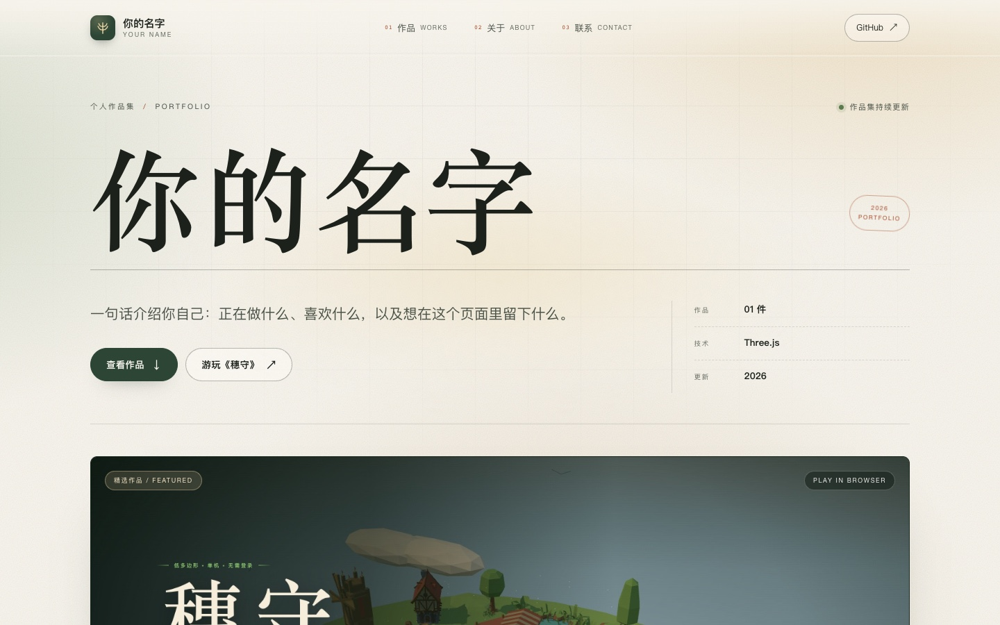

# 个人作品集 · 穗守

这个仓库放着一个个人网站和它陈列的第一件作品——网页游戏《穗守》。

| 入口 | 位置 | 线上地址（启用 Pages 后） |
| --- | --- | --- |
| 个人网站 | [`网站/`](网站/) | <https://kkbott.github.io/botsss/> |
| 游戏《穗守》 | [`游戏/`](游戏/) | <https://kkbott.github.io/botsss/game/> |

网站是纯静态页面，部署在 GitHub Pages 根路径；游戏是 Three.js 静态构建，部署在 `game/` 子路径，从网站首页和作品卡片都能直接进入。



> **上线前需要做的事**
>
> 1. 仓库管理员到 **Settings → Pages → Build and deployment**，把 **Source** 选为 **GitHub Actions**。这一步只有仓库管理员能做，完成后合并到 `main` 的提交会自动构建并部署。
> 2. 网站的姓名、简介、联系方式目前是占位文案，按 [`网站/README.md`](网站/README.md) 替换即可；游戏本身不需要再改。

## 目录结构

```text
.
├── README.md                 # 本文件：仓库导航与说明
├── 网站/                     # 个人作品集（首页、作品、关于、联系）
│   ├── index.html            # 页面结构
│   ├── content.js            # 姓名、简介、联系方式、作品文案（日常只改这个）
│   ├── styles.css            # 样式与响应式布局
│   ├── app.js                # 内容填充与轻交互
│   ├── assets/               # 图片与图标
│   ├── docs/screenshots/     # 改动前后的验收截图（不参与发布）
│   └── README.md             # 给非开发者的改字指南
├── 游戏/                     # 《穗守》：Three.js + TypeScript + Vite
│   ├── src/                  # 游戏源码
│   ├── public/               # CC0 模型资源
│   ├── docs/                 # 游戏验收证据
│   ├── scripts/              # 游戏验收脚本
│   └── README.md             # 游戏说明、玩法与验收结果
└── .github/
    ├── workflows/pages.yml   # 构建 + 部署 GitHub Pages
    └── scripts/build-pages.mjs  # 把网站与游戏构建组装成 _site/
```

根目录只保留导航、说明和部署配置；两个子项目的依赖与构建产物互不影响。

## 本地预览

需要 Node.js 22.12 或以上版本。

```bash
# 1. 构建游戏（安装依赖、类型检查、静态构建到 游戏/dist/）
cd 游戏
npm ci
npm run build
cd ..

# 2. 把网站 + 游戏组装到 _site/：网站位于 /，游戏位于 /game/
node .github/scripts/build-pages.mjs

# 3. 起一个本地静态服务器
python3 -m http.server 8000 --directory _site
# 打开 http://localhost:8000/
```

也可以分别开发：

- 网站：直接编辑 `网站/` 下的文件，双击 `网站/index.html` 就能改字看效果；游戏入口需要上面组装后的完整目录。
- 游戏：`cd 游戏 && npm run dev` 启动 Vite 开发服务器。

`_site/`、`node_modules/`、`dist/` 都已加入 `.gitignore`，不会提交。

## 修改网站内容

日常改字只需要编辑 **[`网站/content.js`](网站/content.js)**。完整的字段说明、添加其他作品和替换图片的方法见 **[`网站/README.md`](网站/README.md)**。

## 部署

- **GitHub Pages**：推送到 `main` 后，[`pages.yml`](.github/workflows/pages.yml) 会安装游戏依赖、构建游戏、组装整站并发布。目标结构是 `站点在 /`、`游戏在 /game/`，与本地组装结果完全一致。开启 Actions 部署前需要管理员在仓库设置里把 Pages 的 Source 设为 GitHub Actions（见文首）。
- **Pull Request**：同一工作流也会运行构建与组装检查，但不会部署；通过即可合并。
- **其他静态托管**：把 `_site/` 整个目录作为站点根目录上传即可，所有链接都是相对路径，放在任意子路径下也能用。

网站与游戏之间使用相对链接（`game/`），因此不依赖仓库名或自定义域名。

## 游戏

《穗守 · Harvest & Hold》是一款单机 3D「种田 × 塔防」网页游戏：种下作物、用金币筑塔、用星辉强化防御，守住六波野兽的进攻。纯静态、无后端，桌面与手机浏览器都能玩。

玩法、操作、内容清单、完整验收结果和素材许可证见 **[`游戏/README.md`](游戏/README.md)**。

## 素材与许可

- 网站的人物姓名、简介、联系方式为占位内容，上线前请替换。
- 游戏使用的外部 3D 美术资源均为 **CC0**，逐项来源与许可证证据见 [`游戏/CREDITS.md`](游戏/CREDITS.md)。
- 游戏代码本身未附带额外开源许可证。
