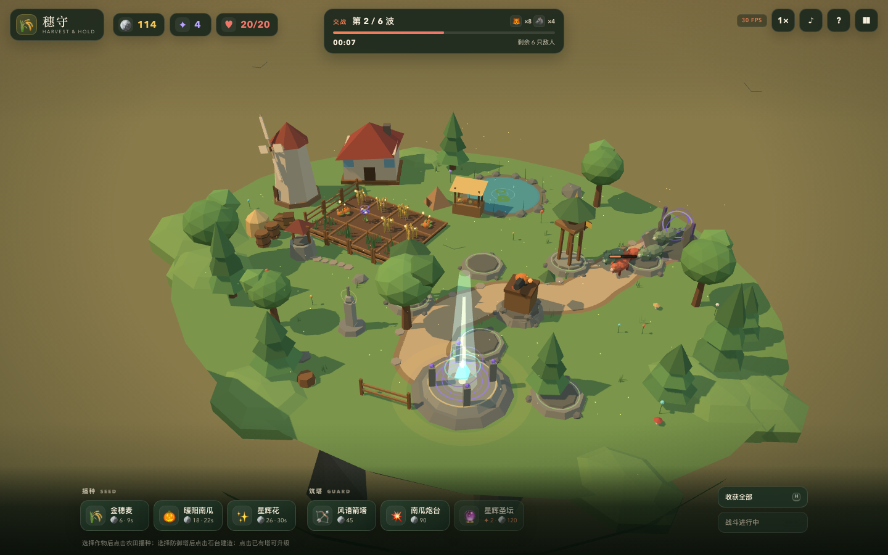
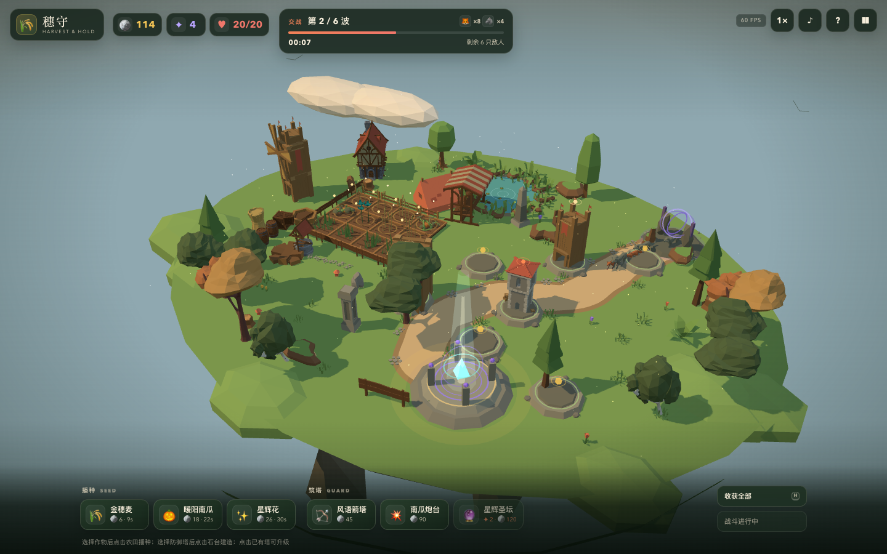
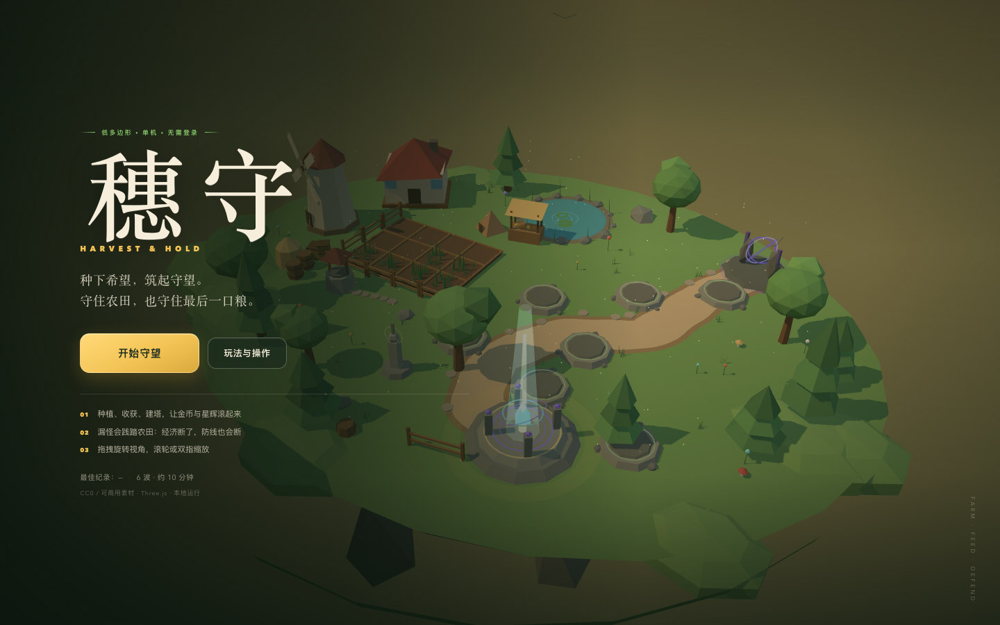
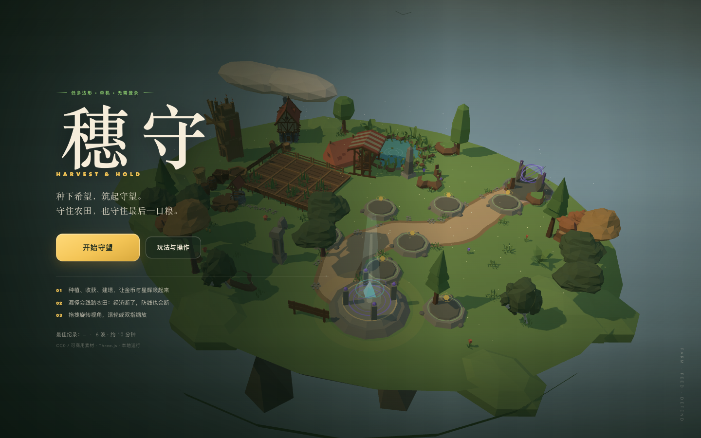

# 穗守 · Harvest & Hold

一个用 **Three.js + TypeScript + Vite** 制作的单机 3D「种田 × 塔防」网页小游戏。
种田赚金币与星辉，用金币建塔，用星辉强化高阶防御；野兽沿石径进攻守望之种，
每次漏怪都会扣生命并烧毁一块农田。守住六波，山野就能迎来下一季。

- 单机、无需登录、无后端；所有玩法状态保存在内存，最佳波次与设置保存在 `localStorage`。
- 纯静态构建，可部署到 GitHub Pages / Netlify / Vercel。
- 低多边形美术来自 **CC0** 的 Quaternius 与 Kenney 素材；程序化生成只作为风格兜底和玩法元素。
- 桌面目标 60fps，窄屏手机可操作。

## 画面与验收证据

| 基线（程序化低多边形 MVP，commit `80abc1f`） | 当前（CC0 素材整合后） |
| --- | --- |
|  |  |
|  |  |

两对截图都是 **1440 × 900**，同一场景状态：8 块作物、3 座防御塔（风语箭塔 Lv.2 / 南瓜炮台 / 风语箭塔）、第 2 波交战、20 生命。基线图来自 commit `80abc1f`；当前图来自本次 PR 的最新提交。

更多截图：`docs/screenshots/after-victory.png`（胜利）、`after-mobile-game.png`（手机游玩）、`after-mobile-menu.png`（手机菜单）、`after-defeat.png`（失败）、`enemy-facing-closeup.png` / `enemy-facing-topdown.png`（怪物朝向修复后的近景与俯视）。

## 快速开始

需要 Node.js `^20.19.0 || >=22.12.0`。

```bash
npm install
npm run dev        # http://localhost:5173
npm run build      # TypeScript 类型检查 + 静态构建到 dist/
npm run preview    # 本地预览生产构建（4173）
```

构建产物 `dist/` 是纯静态文件，没有任何服务端依赖。

### 部署

- **GitHub Pages**：执行 `npm run build`，将 `dist/` 发布到 Pages（项目站点子路径可以直接使用；`vite.config.ts` 的 `base: './'` 已处理相对路径）。
- **Netlify**：Build command `npm run build`，Publish directory `dist`。
- **Vercel**：Framework Preset 选 Vite，Output Directory 为 `dist`。
- 其他静态服务器：把 `dist/` 作为站点根目录即可。

## 玩法

1. **种田**：在底部选择作物，点击农田播种；鼠标按住拖动可连续播种。作物依次经历种子 → 幼苗 → 近成熟 → 成熟四个视觉阶段。
2. **收获**：成熟作物会被金色光圈标记；点击收获，或按 `H` 一键收获。金币是基础经济，星辉花额外产出星辉。
3. **筑塔**：选择防御塔后点击发光石台。点击已有塔查看属性、升级或拆除。升级消耗金币和星辉。
4. **守波**：准备时间结束自动开战；也可以提前迎战领额外金币。漏怪会扣生命、烧毁农田并留下焦土；焦土需要金币修复。
5. **开垦**：初始有 6 块农田，其余 6 块可以花金币逐步开垦。扩大种植是加速经济的核心手段。

### 操作

| 操作 | 键位 / 手势 |
| --- | --- |
| 选择作物 / 防御塔 | `1` `2` `3` / `4` `5` `6` |
| 提前迎战 | `Space` |
| 收获全部 | `H` |
| 双倍速 | `T` |
| 暂停 | `P` / `Esc` |
| 静音 | `M` |
| 旋转相机 / 缩放 | 拖动 / 滚轮或双指 |

手机窄屏上，种子/防御塔卡片可左右滑动；「收获全部」「提前迎战」固定在底栏上方。

## 内容清单

- 12 块农田（6 块初始可用）、3 种作物（金穗麦 / 暖阳南瓜 / 星辉花），每种 4 个视觉生长阶段。
- 7 个防御塔石台、3 种防御塔（风语箭塔 / 南瓜炮台 / 星辉圣坛），各 3 级属性与外观；塔可以金币 + 星辉强化。
- 6 波敌人：赤影狐、苔原狼、荒角蛮牛、幽林鹿王；带准备时间、波次奖励、击杀金币、漏怪惩罚与焦土机制。
- 金币 / 星辉 / 生命 / 波次 HUD；开始、暂停、胜利、失败、帮助流程；`localStorage` 最佳纪录。
- WebAudio 合成音效和环境音乐、低多边形粒子、伤害/建塔/收获反馈。
- 相机拖拽旋转与滚轮/双指缩放；桌面与 390 × 844 窄屏均可操作。

## 验收结果

运行 `npm run build && npm run verify` 可复现。完整机器可读报告在 **[`docs/verification.json`](docs/verification.json)**。

本次验收（本机：macOS arm64、Chromium 158、1440 × 900、Playwright headless 但启用 Metal GPU）结果：

| 检查项 | 结果 |
| --- | --- |
| `npm run build`（类型检查 + 静态构建） | ✅ 退出码 0 |
| 外部 GLB 资产加载 | ✅ 69 / 69，0 错误 |
| 浏览器控制台异常 / 未处理页面错误 | ✅ 0 |
| 帧率（5 秒实测，繁忙交战场景） | ✅ 平均 **60.0 fps**，P95 帧时间 **18.4 ms**；171 draw calls / 157,300 triangles；另有 headed Chromium 实测平均 59.8 fps |
| 种田 → 金币 → 建塔 → 抵御 6 波 → 再投资 | ✅ 自动玩家以正常初始经济打赢 6 波：18 生命、104 击杀、6 座塔、收获 1200 金币 |
| 交互验收 | ✅ 点击播种、拖动连播、点击收获、开垦、建塔、升级、拆除、相机旋转/缩放、暂停/帮助、失败与胜利界面 |
| 怪物模型朝向 | ✅ 模型头部朝向与路径切线一致；自动化回归检查记录 6 / 6 个敌人 facing dot ≈ 1.00 |
| 首页开始按钮 | ✅ 保留可见的实色金色背景，不再依赖会被主题/扩展剥离的纯渐变 |
| 漏怪 / 焦土 | ✅ 漏怪扣生命并烧毁农田；14 金币修复焦土 |
| 移动端（390 × 844） | ✅ 无页面横向溢出；触屏播种可用；底栏操作可见 |
| 所有外部素材许可证 | ✅ 仅 CC0（Kenney Nature Kit 2.1、Quaternius 五个包），证据与逐项清单见 [`CREDITS.md`](CREDITS.md) 和 [`public/assets/quaternius/LICENSE-EVIDENCE.md`](public/assets/quaternius/LICENSE-EVIDENCE.md) |

说明：自动六波验证使用 `?debug=1` 暴露的 `simulate(seconds)` 加速模拟时间，但所有操作仍走正常的种植、收获、建造、升级、波次与经济逻辑，没有通过作弊给资源；UI 交互、帧率与移动端测试使用真实渲染与真实点击。`verify` 会重新构建并在本地 4173 端口启动生产预览后执行。

### 验收项与限制

- **构建**：`npm run build` 无错误；Vite 会提示单个 JS chunk 约 797 kB（gzip 约 209 kB）超过默认提示阈值，这是 Three.js 单包游戏的预期体积，不影响构建。
- **控制台**：自动化验收中未出现未处理异常。使用软件渲染（SwiftShader）时帧率会明显降低，这是测试环境差异，不是逻辑错误。
- **60fps**：已在上述环境实测接近 60fps。目标硬件是中低端笔记本，但不同 GPU/浏览器/高分屏（devicePixelRatio）会有差异；游戏没有做画质菜单，像素比上限为 2（窄屏 1.6）。如果设备较弱，可在 `src/game/world.ts` 中调低 `renderer.setPixelRatio` 上限。
- **首页开始按钮**：按钮现在同时设置实色金色背景和渐变，并去除浏览器原生 button 外观；即使某些主题或浏览器扩展移除了渐变背景，仍会保留金色。
- **移动端**：为窄屏做了布局与触控适配，使玩法可操作，但不是完整的手柄/平板专属 UI；防御塔和作物过多时底栏卡片需要横向滑动。
- **资源取舍**：按要求优先评估了 CC0Tree，但其公开仓库只含 FBX 几何、外部贴图未随仓库发布，且与本项目低多边形风格/生长阶段需求不匹配；因此没有采用或打包其文件。改用 Quaternius + Kenney 的 CC0 GLB 资源，原因与完整证据见 `CREDITS.md`。
- **存档**：游戏进行中的状态只保存在内存；刷新会重新开始一局。最佳波次、胜场和静音设置保存在 `localStorage`。这符合单机、无后端的约束。

## 项目结构

```text
index.html
src/
  main.ts                 # 启动、资产加载进度、程序化 fallback
  style.css               # 响应式 HUD / 菜单 / 弹窗 / 手机底栏
  game/
    config.ts             # 数值、波次、布局、作物/塔/敌人定义
    game.ts               # 游戏状态机、经济、战斗、输入、调试 API
    world.ts              # 浮空岛、石径、农田、石台、环境、光照、合批
    assets.ts             # GLB 资产加载、许可调色、模型归一化、AssetArt
    art.ts                # 美术提供者接口
    models.ts             # 程序化低多边形模型与合批模板（兜底）
    batch.ts              # 静态/模型顶点色合批
    effects.ts            # 粒子与浮动数字
    audio.ts              # WebAudio 合成音效与音乐
    ui.ts                 # HUD / 菜单 / 检查器 / 弹窗
    types.ts
public/
  assets/                 # 已核查许可证的 CC0 资源与 license 证据
  favicon.svg
docs/
  screenshots/            # before / after / victory / mobile 证据
  verification.json       # 最近一次验收报告
scripts/
  verify.mjs              # 构建 + 生产预览 + Playwright 自动验收
  screenshots.mjs         # 生成 after 对比截图
```

### 调试 API

仅在 URL 带 `?debug=1` 时暴露 `window.__fieldguard`（正常游玩不可见）：

```js
window.__fieldguard.getState();             // 金币、生命、波次、塔、地块、敌人……
window.__fieldguard.simulate(10);           // 快进 10 秒游戏逻辑（不改变正常游玩）
window.__fieldguard.addGold(100);           // 仅调试
window.__fieldguard.screenPoint('plot', 0); // 用于自动化点击
```

## 资源与许可证

所有外部美术资源均为 **CC0 1.0**，可商用、可再分发；署名非强制但保留完整记录。资源清单、来源 URL、修改说明、评估后未采用的 CC0Tree 取舍说明，以及程序化生成兜底清单，见 **[`CREDITS.md`](CREDITS.md)**。

- Quaternius 作物 / 动物 / 塔 / 环境模型：CC0；上游页面与下载镜像证据见 `public/assets/quaternius/LICENSE-EVIDENCE.md`。
- Kenney Nature Kit 2.1：CC0；原文见 `public/assets/kenney/License.txt`。
- 音效和音乐为 WebAudio 程序化合成，没有外部音频资源；字体使用系统字体栈。
- Three.js、Vite 等代码依赖使用各自的开放源代码许可证。

## 开发与测试

```bash
npm install
npm run setup:browser   # 首次运行 Playwright 验收前安装 Chromium
npm run verify          # 构建、启动生产预览并执行完整验收
npm run screenshots     # 生成 docs/screenshots/after-*.png
```

`npm run verify` 会运行 37 项检查并更新 `docs/verification.json`；需要先安装 Playwright Chromium。脚本中的自动游玩使用正常经济与 UI/模拟逻辑，不使用 `addGold` 作弊。

## License

游戏代码未附带额外开源许可证；外部美术资源遵循上方 CC0 清单。
