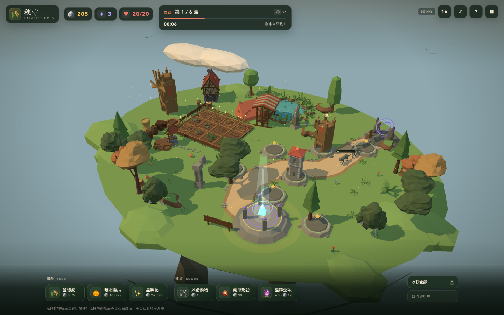
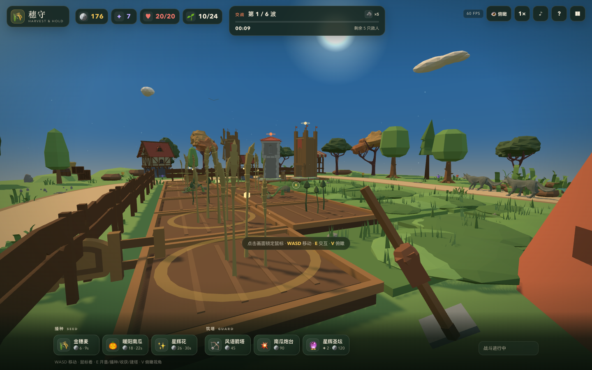
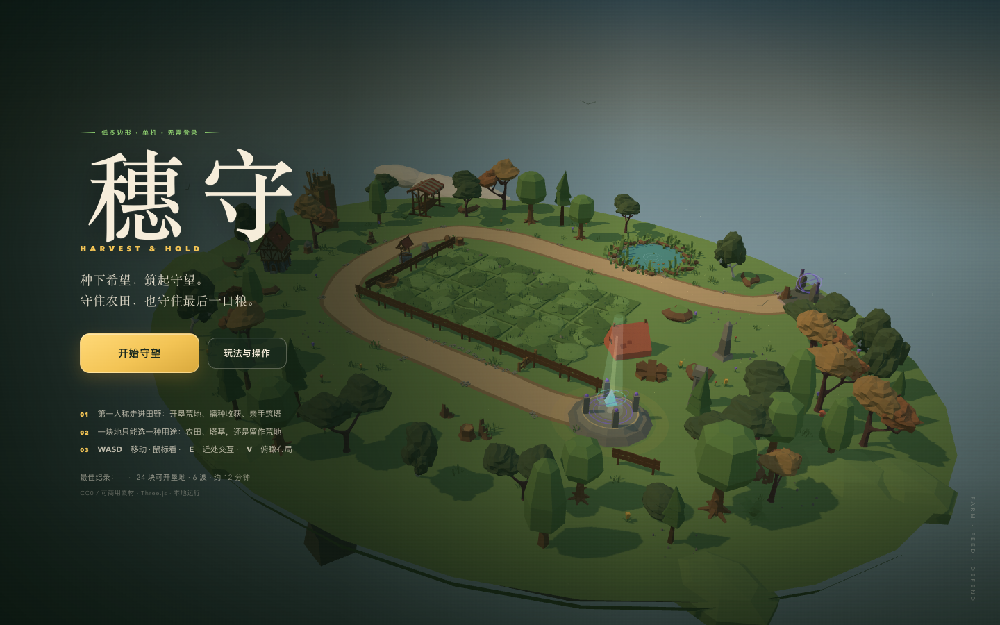
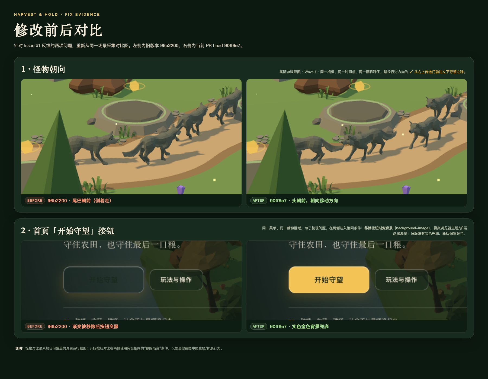

# 穗守 · Harvest & Hold

一个用 **Three.js + TypeScript + Vite** 制作的单机 3D「第一人称种田 × 塔防」网页小游戏。
你以第一人称走进浮空山田，把荒地逐块开垦成农田，播种、收获、把塔建在你自己挑的地块上；
野兽沿石径攻向守望之种，每一次漏怪都会扣生命并烧毁一块作物。守住六波，山野就能迎来下一季。

本目录是仓库里的游戏子项目。线上游戏地址：<https://kkbott.github.io/botsss/game/>，由仓库根目录的 GitHub Actions 随个人网站一起发布；仓库导航见[根目录 README](../README.md)。

- 单机、无需登录、无后端；所有玩法状态保存在内存，最佳波次与设置保存在 `localStorage`。
- 纯静态构建；线上由站点工作流发布到 `/game/`，也可以单独托管。
- 低多边形美术来自 **CC0** 的 Quaternius 与 Kenney 素材；程序化生成只作为风格兜底和玩法元素。
- 桌面目标 60fps，窄屏手机提供虚拟摇杆、触屏视角和交互按钮。

## 画面与验收证据

| 基线：`origin/main` @ `8bc88c2`（轨道相机、12 块农田、7 个固定塔台） | 当前 PR（第一人称、24 块可开垦地、选地建塔） |
| --- | --- |
|  |  |
|  |  |

四张图都是 **1440 × 900**、同一主题与时间段。基线两张来自 `origin/main` 的 `8bc88c2`，
当前两张来自本 PR 最新提交；玩法图都处于第 1 波交战、田里已有作物、场上已有防御塔的状态。
由于本次改造把默认视角从轨道相机换成第一人称，玩法图的机位本身不同：基线是俯视轨道视角，
当前是第一人称站在田边看田间；可切换的俯瞰视角对比见 `docs/screenshots/after-overview.png`。

更多截图：`after-overview.png`（可切换的俯瞰视角）、`after-reclaim.png`（荒地开垦过程动画）、
`after-victory.png`（胜利）、`after-defeat.png`（失败）、`after-mobile-game.png`（手机第一人称）、
`after-mobile-menu.png`（手机菜单）。

### Issue #1 反馈修复对比



这是更早一轮的修复记录，保留在仓库里：左为旧版 `96b2200`（怪物尾巴朝前、按钮在渐变被剥离后变黑），
右为 `90ff6e7`。怪物为真实游戏截图；按钮在两侧使用相同的“移除渐变背景”条件复现主题/扩展行为。

## 快速开始

需要 Node.js `^20.19.0 || >=22.12.0`。

```bash
npm install
npm run dev        # http://localhost:5173
npm run build      # TypeScript 类型检查 + 静态构建到 dist/
npm run preview    # 本地预览生产构建（4173）
```

构建产物 `dist/` 是纯静态文件，没有任何服务端依赖。

### 部署

本游戏随个人网站一起发布：仓库根目录的 [GitHub Actions](../.github/workflows/pages.yml) 会在 `游戏/` 里执行 `npm ci && npm run build`，再把 `dist/` 放到站点的 `game/` 子路径。因此不需要单独配置游戏仓库的 Pages。

如果只想单独托管本游戏，执行 `npm run build`，把 `dist/` 发布到任意静态站点即可：

- **GitHub Pages**：将 `dist/` 作为 Pages 根目录发布（`vite.config.ts` 的 `base: './'` 已处理相对路径，放到子路径也能用）。
- **Netlify**：Build command `npm run build`，Publish directory `dist`。
- **Vercel**：Framework Preset 选 Vite，Output Directory 为 `dist`。
- 其他静态服务器：把 `dist/` 作为站点根目录即可。

## 玩法

这是一局第一人称的“种田 × 塔防”。地块只有三种状态，一块地同一时间只能做一件事：

- **荒地**：开局全部 24 块地都是荒地，长着草、石头和灌木。
- **已开垦农田**：走到荒地旁按 `E` 花金币开垦，开垦需要约 1.6 秒并播放翻土动画；完成之后才能播种。
- **塔基**：选择防御塔后走到荒地或空农田旁按 `E` 建塔，这块地随即变成塔基，不能再种作物；
  拆除塔后地块会恢复到建塔前的状态（荒地仍是荒地，农田仍是农田）。

### 核心循环

1. **走动**：`WASD` 移动，鼠标看四周；点击画面可锁定鼠标（也支持按住拖动视角）。`Space` 跳跃。
2. **开垦**：靠近荒地按 `E`，花金币把它变成农田。开垦费用随已开垦数量递增，先扩哪片地是第一个取舍。
3. **播种 / 收获**：在底部选作物，走到农田旁按 `E` 播种；作物依次经历四个视觉阶段，成熟后再按 `E` 收获金币与星辉。
4. **选地建塔**：在底部选防御塔，走到靠近石径的荒地或空农田旁按 `E` 建塔。塔基会占掉一块地，
   不能继续种作物；靠近塔再按 `E` 打开面板升级或拆除。高阶塔仍然额外消耗星辉。
5. **守波**：准备时间结束自动开战，也可按 `Enter` 提前迎战领额外金币。漏怪会扣生命并烧毁一块作物，
   留下需要金币修复的焦土。

### “先扩哪片地、塔往哪放”

- 农田是 **6 × 4 = 24 块**，北、西、南三面被长约 **67.7 米** 的野兽石径包围；内圈 8 块地更安全，
  适合先开垦种田；外圈地块离石径只有 4–6 米，一级箭塔就能覆盖，适合建塔。
- 塔只能建在地块上：每建一座塔，就少一块可以开垦/种植的土地。外圈地块越早决定用途，收益差别越大。
- 开垦费从 14 金币起，每开垦一块上涨 5 金币（封顶 85）；建塔与前作一样消耗金币，星辉塔消耗星辉。
- 漏怪烧田、焦土修复、作物成熟、波次奖励与最佳纪录都沿用上一版的经济闭环。

### 操作

| 操作 | 键位 / 手势 |
| --- | --- |
| 移动 | `W` `A` `S` `D` |
| 视角 | 鼠标（点击画面锁定；也可按住拖动） |
| 跳跃 | `Space` |
| 交互（开垦 / 播种 / 收获 / 建塔 / 查看塔 / 修复） | `E` |
| 第一人称 / 俯瞰视角 | `V` |
| 选择作物 / 防御塔 | `1` `2` `3` / `4` `5` `6` |
| 提前迎战 | `Enter` |
| 双倍速 | `T` |
| 暂停 | `P` / `Esc` |
| 静音 | `M` |
| 俯瞰视角旋转 / 缩放 | 拖动 / 滚轮或双指 |

手机窄屏上：左下半透明摇杆移动，右侧拖动看视角，右下「交互」按钮操作面前的地块；
底部作物 / 塔卡片可左右滑动。

## 内容清单

- **24 块可开垦地块**，从荒地 → 农田 → 塔基三种状态；地图为 **54 × 42** 的浮空岛，石径约 **67.7 米**。
- 3 种作物（金穗麦 / 暖阳南瓜 / 星辉花），每种 4 个视觉生长阶段。
- 3 种防御塔（风语箭塔 / 南瓜炮台 / 星辉圣坛），各 3 级属性与外观；塔可以金币 + 星辉强化。
- 6 波敌人：赤影狐、苔原狼、荒角蛮牛、幽林鹿王；带准备时间、波次奖励、击杀金币、漏怪惩罚与焦土机制。
- 第一人称角色控制器：WASD、鼠标视角、跳跃、可见的低多边形农夫与手持锄头、行走摆动、
  桌面指针锁定与拖动兜底、手机摇杆与触屏视角。
- 可切换俯瞰轨道视角（保留原来的整岛观察方式，方便规划农田与塔位）。
- 金币 / 星辉 / 生命 / 已开垦数 / 波次 HUD；开始、暂停、胜利、失败、帮助流程；`localStorage` 最佳纪录。
- WebAudio 合成音效和环境音乐、低多边形粒子、伤害/建塔/收获反馈。

## 验收结果

运行 `npm run build && npm run verify` 可复现。完整机器可读报告在 **[`docs/verification.json`](docs/verification.json)**。

本次验收（本机：macOS arm64、Chromium 158、1440 × 900、Playwright headless 但启用 Metal GPU）结果：

| 检查项 | 结果 |
| --- | --- |
| `npm run build`（类型检查 + 静态构建） | ✅ 退出码 0 |
| 外部 GLB 资产加载 | ✅ 69 / 69，0 错误 |
| 浏览器控制台异常 / 未处理页面错误 | ✅ 0 |
| 页面与控件验收 | ✅ **57 / 57** 项通过 |
| 帧率（5 秒实测，第一人称繁忙农田与交战场景） | ✅ 平均 **60.1 fps**，P95 帧时间 **18.3 ms**；146 draw calls / 264,480 triangles |
| 第一人称控制 | ✅ WASD 位移、鼠标看向、Space 跳跃落地、V 双向切换视角 |
| 交互距离 | ✅ 走远时按 E 无反应；走到地块旁才可开垦/播种/收获/建塔/修复 |
| 开垦 | ✅ 金币扣除、1.6 秒过程进度、动画完成后变为农田；费用随开垦数上涨 |
| 选地建塔 | ✅ 荒地建塔、塔基不可播种、拆塔恢复荒地；在农田建塔、拆塔恢复农田 |
| 金币 / 星辉经济 | ✅ 收获进账、建塔扣金币、星辉塔建/升级扣星辉 |
| 漏怪 / 焦土 | ✅ 漏怪扣生命并烧毁作物；焦土可花 14 金币修复 |
| 六波自动通关（正常经济） | ✅ 最终第 6 波胜利：20 生命、114 击杀、10 块农田 + 14 座塔、收获 3,008 金币 |
| 移动端（390 × 844） | ✅ HUD 无溢出；摇杆、交互按钮与触屏开垦可用 |
| 所有外部素材许可证 | ✅ 仅 CC0（Kenney Nature Kit 2.1、Quaternius 五个包），证据与逐项清单见 [`CREDITS.md`](CREDITS.md) 和 [`public/assets/quaternius/LICENSE-EVIDENCE.md`](public/assets/quaternius/LICENSE-EVIDENCE.md) |

说明：自动六波验证使用 `?debug=1` 暴露的 `simulate(seconds)` 加速模拟时间与 `harvestAll()` 便捷操作，
但所有种植、开垦、建塔、升级、拆除、波次与金币/星辉收支都走正常游戏逻辑，没有通过作弊加资源。
第一人称移动、视角、跳跃、交互距离、开垦、播种/收获、建塔/拆塔、暂停/帮助与手机触控使用真实键盘、鼠标/触屏操作。
验收会重新构建，并在本地 4173 端口启动生产预览后执行。

### 验收项与限制

- **构建**：`npm run build` 无错误；Vite 会提示单个 JS chunk 约 821 kB（gzip 约 216 kB）超过默认提示阈值，
  这是 Three.js 单包游戏的预期体积，不影响构建。
- **控制台**：自动化验收中未出现未处理异常。使用软件渲染（SwiftShader）时帧率会明显降低，这是测试环境差异，不是逻辑错误。
- **60fps**：已在上述环境实测接近 60fps。目标硬件是中低端笔记本，但不同 GPU/浏览器/高分屏（devicePixelRatio）会有差异；
  游戏没有做画质菜单，像素比上限为 2（窄屏 1.6）。如果设备较弱，可在 `src/game/world.ts` 中调低 `renderer.setPixelRatio` 上限。
- **第一人称输入**：桌面用 Pointer Lock 锁定鼠标；浏览器拒绝指针锁定时会退化为按住拖动查看。没有手柄支持、
  按键重映射或鼠标灵敏度设置。俯瞰视角沿用 OrbitControls，只用于观察/规划与点选已有塔，不用于种植或建塔。
- **移动端**：提供虚拟摇杆、右侧拖动视角、交互按钮和可滑动工具卡；是可用适配，不是完整的手柄/平板专属 UI。
- **开垦节奏**：同一时间只进行一块地的开垦（约 1.6 秒），避免一次点满整片地；这是有意的操作节奏。
- **平衡**：自动通关验证证明正常经济下可以守成；不同操作速度与开垦顺序会带来不同难度。
- **存档**：游戏进行中的状态只保存在内存；刷新会重新开始一局。最佳波次、胜场和静音设置保存在 `localStorage`。
- **视觉对比说明**：基线图是旧的轨道相机默认视角，当前图是第一人称；两种视角的构图本身不同，
  因此另附 `after-overview.png` 作为同类俯瞰构图参考。所有对比图使用同一视口、主题与相近场景阶段。

## 项目结构

以下路径都相对于本目录（`游戏/`）：

```text
index.html
src/
  main.ts                 # 启动、资产加载进度、程序化 fallback
  style.css               # 响应式 HUD / 菜单 / 弹窗 / 第一人称准星与手机控件
  game/
    config.ts             # 数值、波次、地块/路径布局、作物/塔/敌人定义
    game.ts               # 游戏状态机、经济、战斗、地块状态、交互、调试 API
    player.ts             # 第一人称角色控制器、触屏输入、视角/行走动画
    world.ts              # 浮空岛、石径、荒地/农田/塔基、环境、光照、合批
    assets.ts             # GLB 资产加载、许可调色、模型归一化、AssetArt
    art.ts                # 美术提供者接口
    models.ts             # 程序化低多边形模型、农夫与手持锄头（兜底）
    batch.ts              # 静态/模型顶点色合批
    effects.ts            # 粒子与浮动数字
    audio.ts              # WebAudio 合成音效与音乐
    ui.ts                 # HUD / 菜单 / 检查器 / 弹窗 / 交互提示
    types.ts
public/
  assets/                 # 已核查许可证的 CC0 资源与 license 证据
  favicon.svg
docs/
  screenshots/            # before / after / overview / reclaim / victory / mobile 证据
  verification.json       # 最近一次验收报告
scripts/
  verify.mjs              # 构建 + 生产预览 + Playwright 自动验收（57 项）
  screenshots.mjs         # 生成 after 对比截图
```

### 调试 API

仅在 URL 带 `?debug=1` 时暴露 `window.__fieldguard`（正常游玩不可见）：

```js
window.__fieldguard.getState();          // 金币、生命、地块状态、作物、塔、玩家、敌人……
window.__fieldguard.simulate(10);        // 快进 10 秒游戏逻辑（不改变正常游玩）
window.__fieldguard.addGold(100);        // 仅调试 / 验收布景
window.__fieldguard.facePlot(23);        // 把玩家放到地块附近并看向它（用于验收）
window.__fieldguard.teleport(8, 4);      // 移动玩家（仅调试）
window.__fieldguard.setLook(1.0, -0.1);  // 设置视角（仅调试）
window.__fieldguard.screenPoint('plot', 0);
window.__fieldguard.reclaim(0);          // 走正常扣费与开垦计时
window.__fieldguard.plant(0, 'wheat');   // 走正常扣费
window.__fieldguard.build(0, 'arrow');   // 走正常扣费
```

## 资源与许可证

所有外部美术资源均为 **CC0 1.0**，可商用、可再分发；署名非强制但保留完整记录。资源清单、来源 URL、修改说明、评估后未采用的 CC0Tree 取舍说明，以及程序化生成兜底清单，见 **[`CREDITS.md`](CREDITS.md)**。

- Quaternius 作物 / 动物 / 塔 / 环境模型：CC0；上游页面与下载镜像证据见 `public/assets/quaternius/LICENSE-EVIDENCE.md`。
- Kenney Nature Kit 2.1：CC0；原文见 `public/assets/kenney/License.txt`。
- 音效和音乐为 WebAudio 程序化合成，没有外部音频资源；字体使用系统字体栈。
- Three.js、Vite 等代码依赖使用各自的开放源代码许可证。

## 开发与测试

```bash
npm install
npm run setup:browser   # 首次运行 Playwright 验收前安装 Chromium
npm run verify          # 构建、启动生产预览并执行完整验收（57 项）
npm run screenshots     # 生成 docs/screenshots/after-*.png
```

`npm run verify` 会运行 57 项检查并更新 `docs/verification.json`；需要先安装 Playwright Chromium。
脚本中的自动游玩使用正常经济与游戏逻辑，不使用 `addGold` 作弊。

## License

游戏代码未附带额外开源许可证；外部美术资源遵循上方 CC0 清单。
