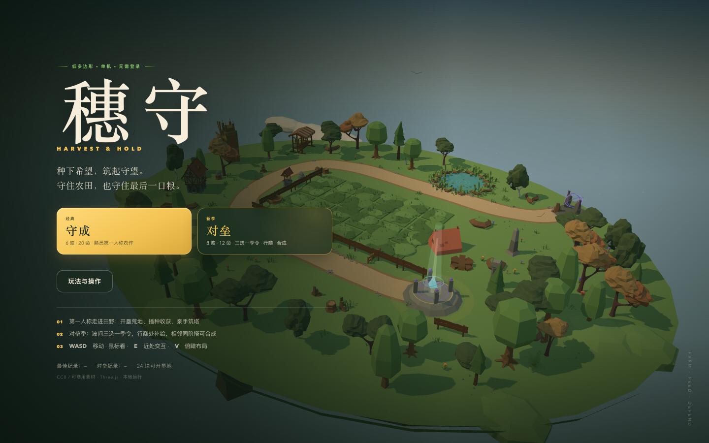
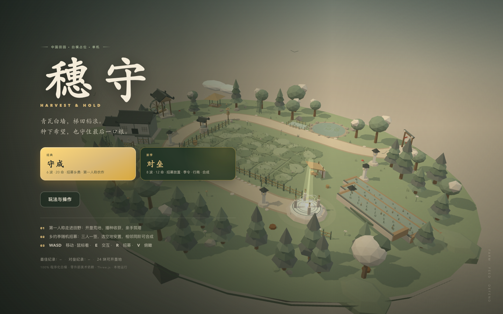
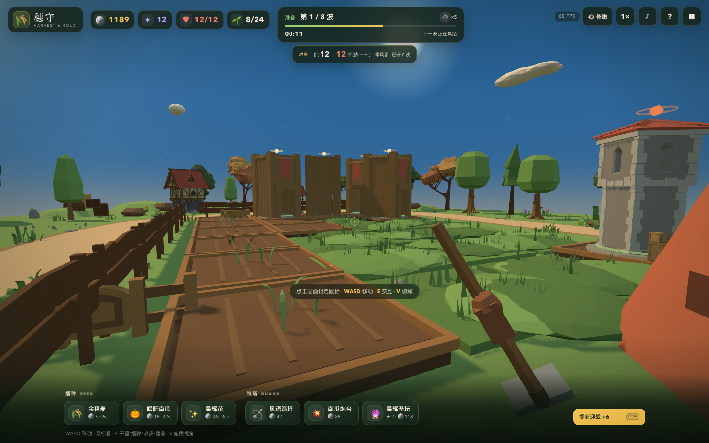
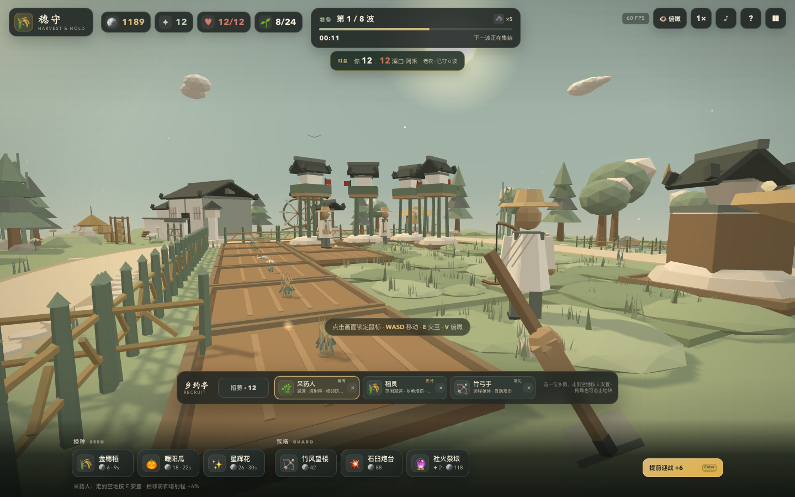
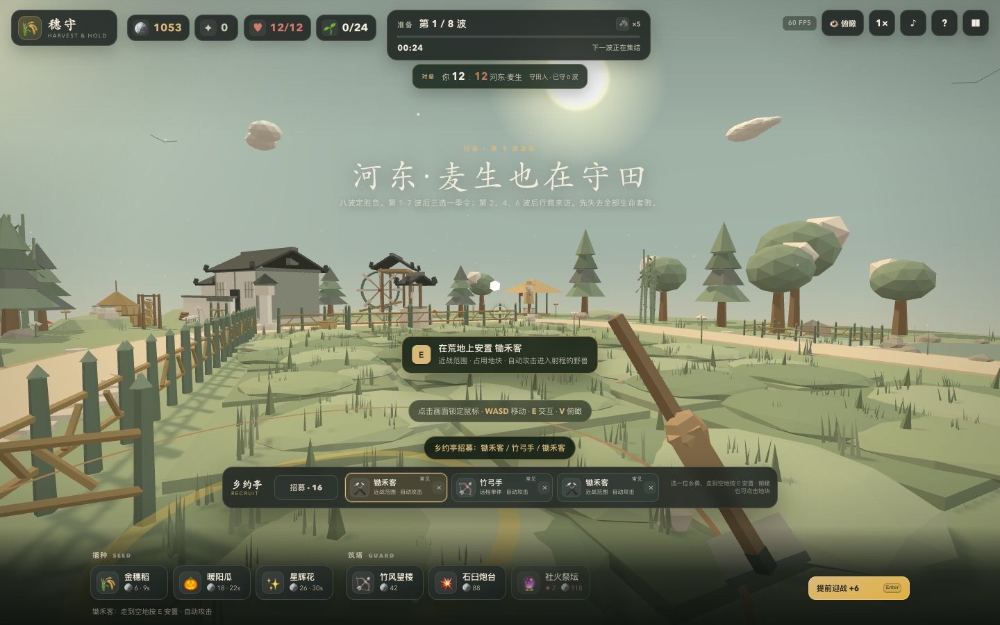
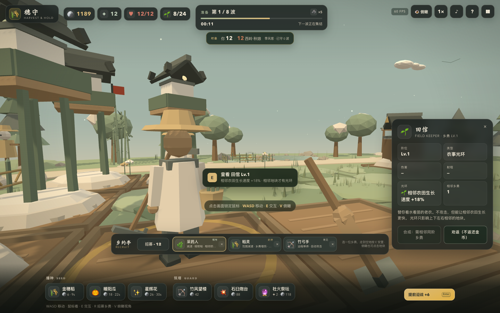
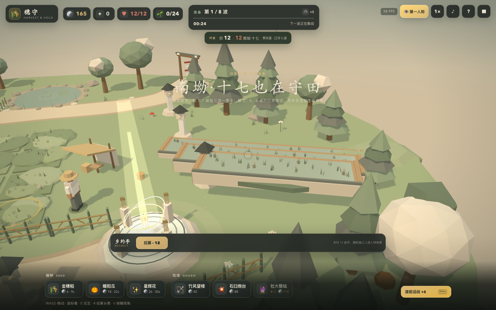
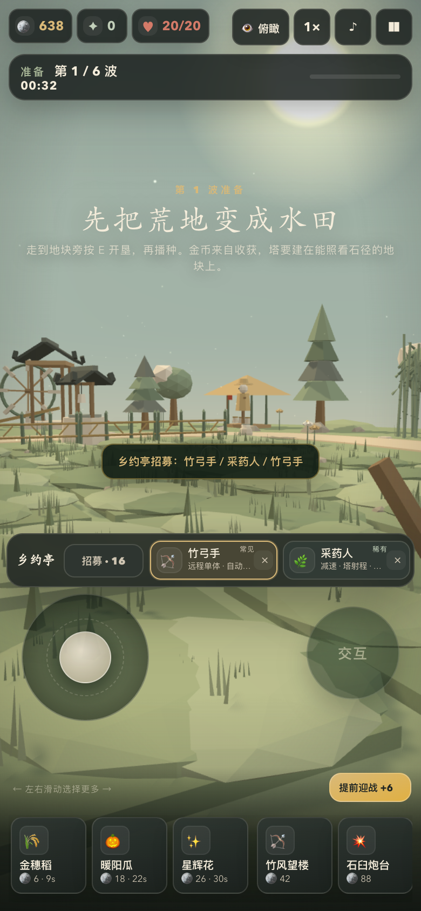

# 穗守 · Harvest & Hold

一个用 **Three.js + TypeScript + Vite** 制作的单机 3D「种田 × 塔防」网页小游戏。
种田赚金币与星辉，用金币建塔，用星辉强化高阶防御；野兽沿石径进攻守望之种，
每次漏怪都会扣生命并烧毁一块农田。v3「中国田园白模季」把美术改成青瓦白墙、
梯田稻浪与竹篱素模，并加入《赵云与阿斗》式的**随机招募乡勇 + 选地放置 + 相邻合成**。

本目录是仓库里的游戏子项目，也是默认的第一人称版。线上游戏地址：<https://kkbott.github.io/botsss/game/>，由仓库根目录的 GitHub Actions 随个人网站一起发布；改造前保留的经典版在 [`游戏经典版/`](../游戏经典版/)，部署在 `/classic/`。仓库导航见[根目录 README](../README.md)。

- 单机、无需登录、无后端；所有玩法状态保存在内存，最佳波次、对垒胜场与设置保存在 `localStorage`。
- 纯静态构建；线上由站点工作流发布到 `/game/`，经典版发布到 `/classic/`，也可以单独托管。
- v3 全部美术为**无贴图程序化白模**，不加载外部 GLB；每件占位物都配有 Blender MCP 生成提示词，方便后续替换成正式模型。
- `public/assets` 里仍保留历史 CC0 素材与许可证证据，但 v3 构建不引用它们；详见 [`CREDITS.md`](CREDITS.md)。
- 桌面目标 60fps，窄屏手机可操作。
- 对垒模式的对手是**本地异步 AI 镜像**，不是联网真人；UI 与文档均明确标注。

## 两种模式

| 模式 | 波数 | 生命 | 核心差异 |
| --- | --- | --- | --- |
| **守成（经典）** | 6 | 20 | 第一人称开垦/播种/建塔 + 乡约亭随机招募，适合熟悉操作 |
| **对垒（新季）** | 8 | 12 | 第 1–7 波后三选一「季令」、第 2/4/6 波后「行商」、相邻同阶塔/乡勇「合成」、异步 AI 对手生命赛跑 |

### 画面与验收证据（v3 中国田园白模）

**修改前（#8 `8d6bd76`）→ 修改后（v3 中国田园白模 + 随机招募）**

| 修改前菜单 | 修改后菜单 |
| --- | --- |
|  |  |

| 修改前局内（西式 CC0 素材） | 修改后局内（白模 + 乡勇 + 招募条） |
| --- | --- |
|  |  |

| 随机招募三人 | 乡勇检查器 |
| --- | --- |
|  |  |

| 梯田与稻田 | 移动端招募 |
| --- | --- |
|  |  |

**白模类别图**：[总览](docs/screenshots/whitebox-overview.png) · [环境与建筑](docs/screenshots/whitebox-environment.png) · [防御塔](docs/screenshots/whitebox-tower.png) · [乡勇](docs/screenshots/whitebox-guardian.png) · [作物](docs/screenshots/whitebox-crop.png) · [野兽](docs/screenshots/whitebox-enemy.png) · [玩家](docs/screenshots/whitebox-player.png)

白模不是最终美术：36 件占位物的尺寸、比例、朝向、面数预算和 GLB 导出参数见 [`docs/whitebox-blender-prompts.md`](docs/whitebox-blender-prompts.md)，机器可读清单见 [`src/game/whitebox-assets.json`](src/game/whitebox-assets.json)。完整的 v3 设计与边界规则见 [`docs/design-v3-pastoral.md`](docs/design-v3-pastoral.md)。

## 快速开始

需要 Node.js `^20.19.0 || >=22.12.0`。

```bash
npm install
npm run dev        # http://localhost:5173
npm run build      # TypeScript 类型检查 + 静态构建到 dist/
npm run preview    # 本地预览生产构建（4173）
```

构建产物 `dist/` 是纯静态文件，没有任何服务端依赖。

### 部署

本游戏随个人网站一起发布：仓库根目录的 [GitHub Actions](../.github/workflows/pages.yml) 会在 `游戏/` 和 `游戏经典版/` 里分别执行 `npm ci && npm run build`，再把两个 `dist/` 放到站点的 `game/`、`classic/` 子路径。因此不需要单独配置游戏仓库的 Pages。

如果只想单独托管本游戏，执行 `npm run build`，把 `dist/` 发布到任意静态站点即可：

- **GitHub Pages**：将 `dist/` 作为 Pages 根目录发布（`vite.config.ts` 的 `base: './'` 已处理相对路径，放到子路径也能用）。
- **Netlify**：Build command `npm run build`，Publish directory `dist`。
- **Vercel**：Framework Preset 选 Vite，Output Directory 为 `dist`。
- 其他静态服务器：把 `dist/` 作为站点根目录即可。

## 玩法

### 经典守成（6 波）

1. **种田**：在底部选择作物，走到农田旁按 `E` 播种；作物依次经历种子 → 幼苗 → 近成熟 → 成熟四个阶段。作物白模通过同一模型缩放表现四个阶段。
2. **收获**：成熟作物会发光；按 `E` 收获，或按 `H` 一键收获。金币是基础经济，星辉花额外产出星辉。
3. **筑塔**：选择防御塔，走到荒地或空农田旁按 `E` 建塔；点击已有塔查看属性、升级或拆除。
4. **守波**：准备结束自动开战，或提前迎战领额外金币。漏怪会扣生命、烧毁农田并留下焦土。
5. **开垦**：24 块地初始全为荒地；开垦费 14 起、每块 +5、封顶 85，一次只能开垦一块。

### 乡勇招募（两种模式）

1. **乡约亭**：底部中央的招募条；点「招募」或按 `R`，支付递增金币，随机抽三名乡勇进入待命席。
2. **随机**：竹弓手 / 锄禾客 / 田倌 / 采药人 / 石匠 / 稻灵，权重与稀有度不同；同一批最多两张重复。
3. **放置**：选一位乡勇，走到荒地或空农田按 `E`（或俯瞰点击地块）安置；占用地块，不能与塔/作物共存。
4. **光环**：田倌加速相邻农田，采药人增加相邻塔射程，石匠增加相邻塔伤害，稻灵增加相邻乡勇伤害；只影响上下左右。
5. **合成**：两名相邻、同类型、同阶乡勇合成高一阶；劝返不返还金币，避免套利。

### 对垒（8 波，新季）

1. **对手**：开局随机一位异步 AI 对手（如“北坡·老秦”），双方各 12 命；顶部对垒条实时显示双方生命。
2. **季令**：第 1–7 波清除后，从三项季令中选一项，整局有效。14 种季令，分普通/稀有/史诗，可叠加，有上限。
3. **行商**：第 2/4/6 波后出现。用金币买星辉、生命上限、地契、精铁或种子袋；每次限购 2 件，可花递增金币刷新。
4. **合成**：两座**正交相邻**、同类型、同等级的塔可以合成高一阶塔；免费升阶，但会消耗另一座塔并腾出一块地。
5. **对垒结算**：先失去全部生命者败；第 8 波结束双方存活时，生命多者胜，同命比收获金币。
6. **弱橡皮筋**：只有玩家落后 4 命以上时，对手才会额外漏 1 只；玩家领先时不会削弱对手。

### 操作

| 操作 | 键位 / 手势 |
| --- | --- |
| 移动 / 视角 | `W` `A` `S` `D` / 鼠标；手机左摇杆 + 右侧拖动 |
| 交互（开垦/播种/收获/建塔/查看） | `E` / 手机「交互」按钮 |
| 选择作物 / 防御塔 | `1` `2` `3` / `4` `5` `6` |
| 招募乡勇 | `R` |
| 选择待命乡勇 | `7` `8` `9` |
| 第一人称 / 俯瞰 | `V` |
| 提前迎战 | `Enter` |
| 收获全部 | `H` |
| 双倍速 | `T` |
| 暂停 | `P` / `Esc` |
| 静音 | `M` |

手机窄屏上，种子/防御塔卡片可左右滑动；「收获全部」「提前迎战」固定在底栏上方。

## 内容清单

- **24 块可开垦地**（6×4），荒地 / 农田 / 塔基 / 乡勇驻地四态；开垦动画、塔基不可种、拆塔/劝返恢复原状、焦土修复。
- **3 种作物**：金穗稻 / 暖阳瓜 / 星辉花，各 4 个生长阶段（同一白模缩放）。
- **3 种防御塔**：竹风望楼 / 石臼炮台 / 社火祭坛，各 3 级属性与外观；金币 + 星辉升级。
- **合成**：相邻同类型同等级塔或乡勇免费升阶，消耗一方、腾出一块地；Lv.3 封顶。
- **6 种可招募乡勇**：竹弓手、锄禾客、田倌、采药人、石匠、稻灵；随机权重、三级成长、相邻光环。
- **36 件中国田园白模**：18 件环境/建筑 + 3 作物 + 3 塔 + 6 乡勇 + 4 野兽 + 2 玩家；逐项 Blender MCP 提示词。
- **14 种季令**：经济、攻速、射程、生命、商店、合成六类 build 方向。
- **5 种行商商品**：星辉瓶、护田符、地契、精铁、种子袋；限购 2、可刷新。
- **经典 6 波 + 对垒 8 波**：赤狐 / 灰狼 / 荒角野猪 / 白鹿王四种野兽；对垒第 7/8 波“长夜追猎 / 双王临门”加压。
- **异步 AI 对垒**：对手名字/称号/水平随机，生命赛跑，失误波与弱橡皮筋。
- 开始、暂停、胜利、失败、帮助流程；`localStorage` 最佳纪录/对垒胜场/静音。
- WebAudio 合成音效与环境音乐、素模粒子、伤害/建塔/收获反馈。
- 桌面与 390 × 844 窄屏均可操作；双模式菜单、季令/行商弹窗均适配手机。

## 验收结果

运行 `npm run build && npm run verify` 可复现。完整机器可读报告在 **[`docs/verification.json`](docs/verification.json)**。

本次验收（本机：macOS arm64、Chromium 158、1440 × 900、Playwright headless 但启用 Metal GPU）结果：

| 检查项 | 结果 |
| --- | --- |
| `npm run build`（类型检查 + 静态构建） | ✅ 退出码 0 |
| 总验收项 | ✅ **92 / 92** |
| 外部 GLB 依赖 | ✅ 0 运行时请求；`whitebox` 模式，0 错误 |
| 浏览器控制台异常 / 未处理页面错误 | ✅ 0 |
| 帧率（5 秒实测，繁忙交战场景） | ✅ 平均 **60.1 fps**，P95 帧时间 **18.6 ms**；198 draw calls / 104,320 triangles |
| 经典六波正常经济通关 | ✅ 20 生命、114 击杀、14 座塔、收获 2,960 金币 |
| 对垒 8 波状态机 | ✅ 12 生命、7 次季令、5 次合成，第 8 波胜利 |
| 随机招募 | ✅ 扣金币、3 张随机牌、同批最多两张重复、下一批涨价 |
| 放置 / 合成 / 光环 | ✅ 空地放置占用、相邻同阶合成 Lv.2、田倌相邻作物生长 +18%、乡勇实战产生击杀 |
| 白模清单 | ✅ 36 件全部渲染，36 条提示词与 JSON 清单一一对应 |
| 季令三选一 | ✅ 波次清除后 3 张不重复、选择后叠层、模拟冻结 |
| 行商 | ✅ 第 2 波后出现、限购 2、购买生效、刷新扣费 |
| 合成 | ✅ 相邻同阶可合、Lv.2、被合塔地块恢复 |
| 对垒失败 | ✅ 无塔漏怪至 0 命，结算页出现 |
| 移动端（390 × 844） | ✅ 双模式菜单、对垒 HUD、招募条、季令弹窗无横向溢出 |
| 所有外部素材许可证 | ✅ 历史文件仅 CC0（Kenney Nature Kit 2.1、Quaternius 五个包）；v3 不加载，证据见 [`CREDITS.md`](CREDITS.md) |

说明：自动六波/对垒验证使用 `?debug=1` 暴露的 `simulate(seconds)` 加速模拟时间，但所有种植、收获、建造、升级、合成、季令、行商、招募、放置与战斗都走正常游戏逻辑；随机招募与 UI 检查使用真实点击。乡勇合成/光环的确定性检查使用 `addGuardianCard` 调试入口建立牌面，不改变正常游玩抽卡概率。对垒完整跑通使用调试布景（提前给金币/星辉并预置塔）来验证状态机，不代表真实经济平衡；真实经济由经典六波自动玩家验证。

### 验收项与限制

- **构建**：`npm run build` 无错误；Vite 会提示单个 JS chunk 约 820 kB（gzip 约 217 kB）超过默认提示阈值，这是 Three.js 单包游戏的预期体积，不影响构建。
- **对垒 PvP**：是本地异步 AI 镜像，不是联网真人；没有后端、账号、房间、排行榜服务器。UI 和 PR 均明确标注。
- **平衡**：季令/行商/8 波/乡勇数值为第一版；自动玩家偏强，真人手速/操作会显著影响收入与漏怪。需要真人 playtest 继续调参。
- **白模**：v3 是白模占位，不是最终中国田园美术；36 件占位物待按提示词生成正式 GLB 后替换。
- **未实现**：每日轮换、赛季、联网 PvP、武将字谜/武器、正式 GLB 美术、焦点陷阱/完整无障碍。设计见 `docs/design-v2.md` 与 `docs/design-v3-pastoral.md` 的后续路线。
- **存档**：进行中的状态只保存在内存；刷新会重新开始一局。最佳波次、对垒胜场、静音设置保存在 `localStorage`。
- **移动端**：为窄屏做了布局与触控适配，但不是完整的手柄/平板专属 UI；防御塔和作物过多时底栏卡片需要横向滑动。

## 项目结构

以下路径都相对于本目录（`游戏/`）：

```text
index.html
src/
  main.ts                 # 启动、加载进度、白模实例化、?gallery=1 入口
  gallery.ts              # ?gallery=1 白模陈列页（36 件、类别/单项筛选）
  style.css               # 响应式 HUD / 菜单 / 弹窗 / 手机底栏 / 季令 / 行商 / 乡约亭
  game/
    config.ts             # 数值、波次、布局、作物/塔/乡勇/敌人、季令、行商、招募、对垒规则
    game.ts               # 状态机、经济、战斗、季令、行商、合成、异步对手、输入、debug API
    world.ts              # 浮空岛、石径、农田、环境、光照、合批
    assets.ts             # 历史 GLB 加载器（v3 不再由 main 调用，保留以对照/回退）
    art.ts                # 美术提供者接口
    models.ts             # 中国田园白模模型、环境构建器、WHITEBOX_BUILDERS 注册表
    batch.ts              # 静态/模型顶点色合批
    effects.ts            # 粒子与浮动数字
    audio.ts              # WebAudio 合成音效与音乐
    ui.ts                 # HUD / 菜单 / 检查器 / 乡约亭 / 季令 / 行商 / 弹窗
    player.ts             # 第一人称控制器
    types.ts
public/
  assets/                 # 历史 CC0 资源与 license 证据（v3 运行时不加载）
  favicon.svg
docs/
  research-zhaoyun-adou.md # 《赵云与阿斗》调研
  design-v2.md             # v2 对垒季设计
  design-v3-pastoral.md    # v3 中国田园白模与随机招募设计
  whitebox-blender-prompts.md # 36 件白模的 Blender MCP 提示词
  verification.json        # 最近一次验收报告
  screenshots/             # before / after / victory / mobile / 白模证据
scripts/
  verify.mjs              # 构建 + 生产预览 + Playwright 自动验收
  screenshots.mjs         # 生成 PR #6 时期 after 对比截图
  screenshots-v2.mjs      # 生成 v2 对垒季 after 截图
  screenshots-pastoral.mjs # 生成 v3 中国田园/招募/白模截图
  build-whitebox-doc.mjs  # 从 JSON 生成白模提示词文档
```

### 调试 API

仅在 URL 带 `?debug=1` 时暴露 `window.__fieldguard`（正常游玩不可见）：

```js
window.__fieldguard.getState();              // 金币、生命、对垒、季令、行商、塔、乡勇、待命席、地块、敌人……
window.__fieldguard.simulate(10);            // 快进 10 秒游戏逻辑（不改变正常游玩）
window.__fieldguard.addGold(100);            // 仅调试
window.__fieldguard.startVersus();           // 直接进入对垒模式
window.__fieldguard.chooseBlessing('gale');  // 选择季令（调试）
window.__fieldguard.buyShopItem('iron');     // 购买行商商品（调试）
window.__fieldguard.merge(18);               // 合成指定地块的塔（调试）
window.__fieldguard.selectTowerAt(18);       // 打开塔检查器（调试）
window.__fieldguard.recruit();                // 招募一批（调试）
window.__fieldguard.selectGuardian(uid);     // 选择待命乡勇
window.__fieldguard.placeGuardian(18, uid);  // 安置乡勇
window.__fieldguard.mergeGuardian(18);       // 合成乡勇
window.__fieldguard.addGuardianCard('fieldhand', 2); // 仅验收用
window.__fieldguard.recruit();                // 招募一批（调试）
window.__fieldguard.selectGuardian(uid);     // 选择待命乡勇
window.__fieldguard.placeGuardian(18, uid);  // 安置乡勇
window.__fieldguard.mergeGuardian(18);       // 合成乡勇
window.__fieldguard.addGuardianCard('fieldhand', 2); // 仅验收用
window.__fieldguard.screenPoint('plot', 0);  // 用于自动化点击
```

## 资源与许可证

v3 运行时不加载任何外部 3D 模型，全部为程序化白模；历史外部美术资源均为 **CC0 1.0**，保留在 `public/assets/` 作为对照与许可证证据，可商用、可再分发。完整清单、来源 URL、修改说明、CC0Tree 取舍说明与白模清单见 **[`CREDITS.md`](CREDITS.md)**。

- Quaternius 作物 / 动物 / 塔 / 环境模型（历史文件，v3 不加载）：CC0；上游页面与下载镜像证据见 `public/assets/quaternius/LICENSE-EVIDENCE.md`。
- Kenney Nature Kit 2.1（历史文件，v3 不加载）：CC0；原文见 `public/assets/kenney/License.txt`。
- 36 件中国田园白模与 Blender MCP 提示词：程序化生成，无外部素材；见 [`docs/whitebox-blender-prompts.md`](docs/whitebox-blender-prompts.md)。
- 音效和音乐为 WebAudio 程序化合成，没有外部音频资源；字体使用系统字体栈。
- Three.js、Vite 等代码依赖使用各自的开放源代码许可证。

## 开发与测试

```bash
npm install
npm run setup:browser   # 首次运行 Playwright 验收前安装 Chromium
npm run verify          # 构建、启动生产预览并执行完整验收
npm run screenshots     # 生成 PR #6 时期的 after-*.png
npm run screenshots:v2  # 生成 v2 对垒季 after-v2-*.png
npm run screenshots:pastoral # 生成 v3 田园/招募/白模截图
npm run screenshots:baseline # 在 8d6bd76 worktree 里生成 before-pastoral-*.png
npm run docs:whitebox   # 从 whitebox-assets.json 生成提示词文档
```

`npm run verify` 会运行 92 项检查并更新 `docs/verification.json`；需要先安装 Playwright Chromium。脚本中的自动游玩使用正常经济与 UI/模拟逻辑；对垒完整状态机与乡勇合成/光环检查使用调试布景，已在验收说明中标注。

## License

游戏代码未附带额外开源许可证；历史外部美术资源遵循上方 CC0 清单，v3 白模由项目代码生成。
