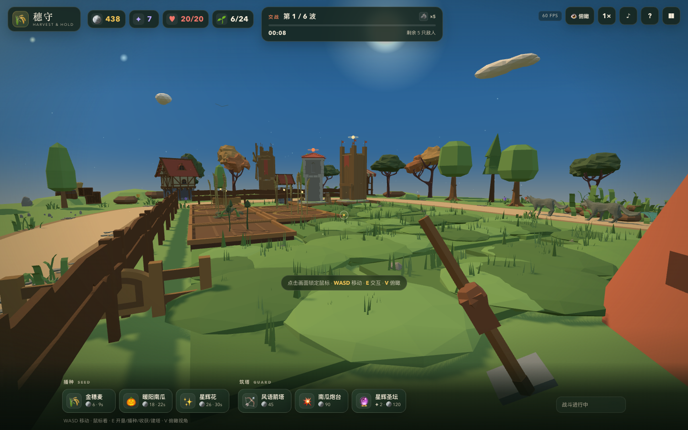
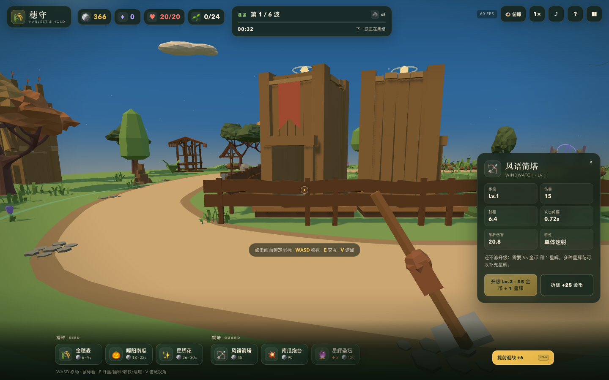
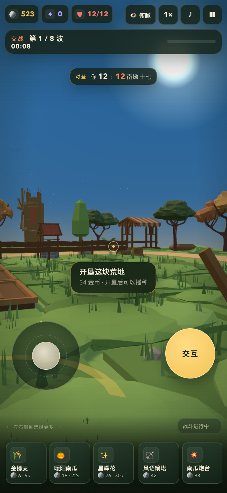
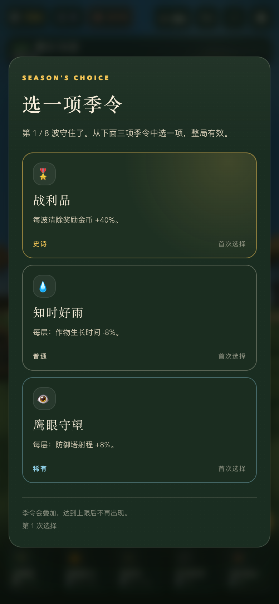
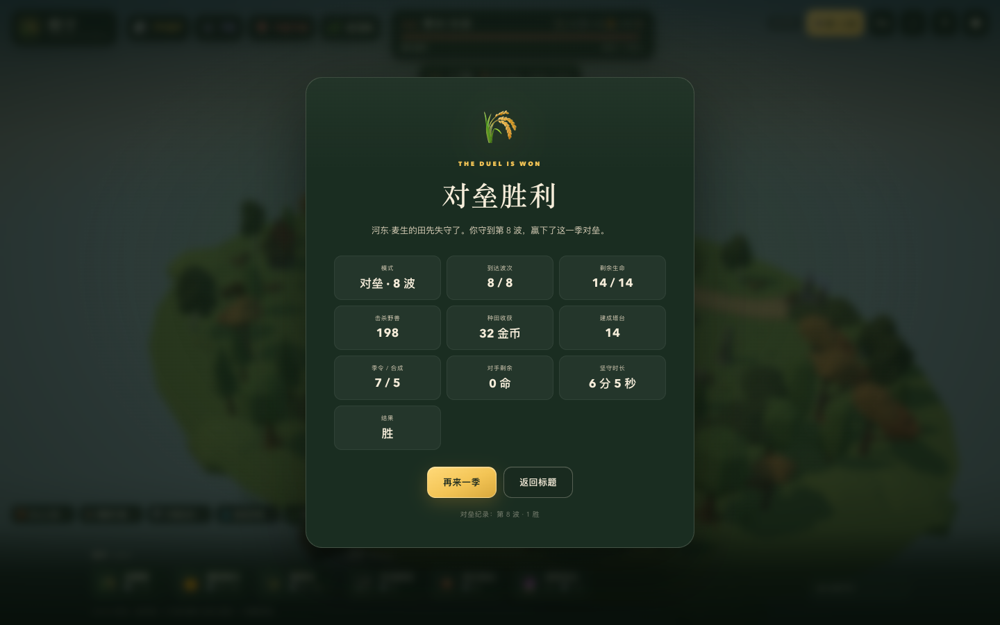

# 穗守 · Harvest & Hold

一个用 **Three.js + TypeScript + Vite** 制作的单机 3D「种田 × 塔防」网页小游戏。
种田赚金币与星辉，用金币建塔，用星辉强化高阶防御；野兽沿石径进攻守望之种，
每次漏怪都会扣生命并烧毁一块农田。守住八波，山野就能迎来下一季。

本目录是仓库里的游戏子项目，也是默认的第一人称版。线上游戏地址：<https://kkbott.github.io/botsss/game/>，由仓库根目录的 GitHub Actions 随个人网站一起发布；改造前保留的经典版在 [`游戏经典版/`](../游戏经典版/)，部署在 `/classic/`。仓库导航见[根目录 README](../README.md)。

- 单机、无需登录、无后端；所有玩法状态保存在内存，最佳波次、对垒胜场与设置保存在 `localStorage`。
- 纯静态构建；线上由站点工作流发布到 `/game/`，经典版发布到 `/classic/`，也可以单独托管。
- 低多边形美术来自 **CC0** 的 Quaternius 与 Kenney 素材；程序化生成只作为风格兜底和玩法元素。
- 桌面目标 60fps，窄屏手机可操作。
- 对垒模式的对手是**本地异步 AI 镜像**，不是联网真人；UI 与文档均明确标注。

## 两种模式

| 模式 | 波数 | 生命 | 核心差异 |
| --- | --- | --- | --- |
| **守成（经典）** | 6 | 20 | 第一人称开垦/播种/建塔，适合熟悉操作 |
| **对垒（新季）** | 8 | 12 | 第 1–7 波后三选一「季令」、第 2/4/6 波后「行商」、相邻同阶塔「合成」、异步 AI 对手生命赛跑 |

### 画面与验收证据

**修改前（PR #6 基线 `8e3129f`）→ 修改后（v2 对垒季）**

| 修改前菜单 | 修改后菜单 |
| --- | --- |
|  |  |

| 修改前局内（经典 6 波） | 修改后局内（对垒 8 波 + 对垒条 + 季令栏） |
| --- | --- |
|  |  |

| 修改前清波（只有准备计时） | 修改后清波（三选一季令） |
| --- | --- |
|  |  |

| 修改前检查器（升级/拆除） | 修改后检查器（相邻同阶可合成） |
| --- | --- |
|  |  |

| 行商 | 移动端 HUD | 移动端季令 |
| --- | --- | --- |
|  |  |  |

| 移动端菜单（修改前） | 移动端菜单（修改后） |
| --- | --- |
|  |  |

对垒结算：



所有 v2 对比图均为 **1440 × 900**，修改前后使用同一视口与相近场景阶段（第 1–2 波、已有农田与塔）。修改前截图来自 PR #6 `8e3129f` 的独立构建；修改后截图来自本 PR 的生产构建。

完整的玩法调研与设计文档：

- [`docs/research-zhaoyun-adou.md`](docs/research-zhaoyun-adou.md)：抖音小游戏《赵云与阿斗》的玩法、系统、经济、商店、格子扩张、PvP、玩家反馈与隐藏机制调研（含证据分级）。
- [`docs/design-v2.md`](docs/design-v2.md)：本次《穗守》整套玩法设计、数值表、边界规则、前后对照与后续路线。

## 快速开始

需要 Node.js `^20.19.0 || >=22.12.0`。

```bash
npm install
npm run dev        # http://localhost:5173
npm run build      # TypeScript 类型检查 + 静态构建到 dist/
npm run preview    # 本地预览生产构建（4173）
```

构建产物 `dist/` 是纯静态文件，没有任何服务端依赖。

### 部署

本游戏随个人网站一起发布：仓库根目录的 [GitHub Actions](../.github/workflows/pages.yml) 会在 `游戏/` 和 `游戏经典版/` 里分别执行 `npm ci && npm run build`，再把两个 `dist/` 放到站点的 `game/`、`classic/` 子路径。因此不需要单独配置游戏仓库的 Pages。

如果只想单独托管本游戏，执行 `npm run build`，把 `dist/` 发布到任意静态站点即可：

- **GitHub Pages**：将 `dist/` 作为 Pages 根目录发布（`vite.config.ts` 的 `base: './'` 已处理相对路径，放到子路径也能用）。
- **Netlify**：Build command `npm run build`，Publish directory `dist`。
- **Vercel**：Framework Preset 选 Vite，Output Directory 为 `dist`。
- 其他静态服务器：把 `dist/` 作为站点根目录即可。

## 玩法

### 经典守成（6 波）

1. **种田**：在底部选择作物，走到农田旁按 `E` 播种；作物依次经历种子 → 幼苗 → 近成熟 → 成熟四个阶段。
2. **收获**：成熟作物会发光；按 `E` 收获，或按 `H` 一键收获。金币是基础经济，星辉花额外产出星辉。
3. **筑塔**：选择防御塔，走到荒地或空农田旁按 `E` 建塔；点击已有塔查看属性、升级或拆除。
4. **守波**：准备结束自动开战，或提前迎战领额外金币。漏怪会扣生命、烧毁农田并留下焦土。
5. **开垦**：24 块地初始全为荒地；开垦费 14 起、每块 +5、封顶 85，一次只能开垦一块。

### 对垒（8 波，新季）

1. **对手**：开局随机一位异步 AI 对手（如“北坡·老秦”），双方各 12 命；顶部对垒条实时显示双方生命。
2. **季令**：第 1–7 波清除后，从三项季令中选一项，整局有效。14 种季令，分普通/稀有/史诗，可叠加，有上限。
3. **行商**：第 2/4/6 波后出现。用金币买星辉、生命上限、地契、精铁或种子袋；每次限购 2 件，可花递增金币刷新。
4. **合成**：两座**正交相邻**、同类型、同等级的塔可以合成高一阶塔；免费升阶，但会消耗另一座塔并腾出一块地。
5. **对垒结算**：先失去全部生命者败；第 8 波结束双方存活时，生命多者胜，同命比收获金币。
6. **弱橡皮筋**：只有玩家落后 4 命以上时，对手才会额外漏 1 只；玩家领先时不会削弱对手。

### 操作

| 操作 | 键位 / 手势 |
| --- | --- |
| 移动 / 视角 | `W` `A` `S` `D` / 鼠标；手机左摇杆 + 右侧拖动 |
| 交互（开垦/播种/收获/建塔/查看） | `E` / 手机「交互」按钮 |
| 选择作物 / 防御塔 | `1` `2` `3` / `4` `5` `6` |
| 第一人称 / 俯瞰 | `V` |
| 提前迎战 | `Enter` |
| 收获全部 | `H` |
| 双倍速 | `T` |
| 暂停 | `P` / `Esc` |
| 静音 | `M` |

手机窄屏上，种子/防御塔卡片可左右滑动；「收获全部」「提前迎战」固定在底栏上方。

## 内容清单

- **24 块可开垦地**（6×4），荒地 / 农田 / 塔基三态；开垦动画、塔基不可种、拆塔恢复原状、焦土修复。
- **3 种作物**：金穗麦 / 暖阳南瓜 / 星辉花，各 4 个视觉生长阶段。
- **3 种防御塔**：风语箭塔 / 南瓜炮台 / 星辉圣坛，各 3 级属性与外观；金币 + 星辉升级。
- **合成**：相邻同类型同等级塔免费升阶，消耗一座塔、腾出一块地；Lv.3 封顶。
- **14 种季令**：经济、攻速、射程、生命、商店、合成六类 build 方向。
- **5 种行商商品**：星辉瓶、护田符、地契、精铁、种子袋；限购 2、可刷新。
- **经典 6 波 + 对垒 8 波**：狐/狼/牛/鹿王四种敌人；对垒第 7/8 波“长夜追猎 / 双王临门”加压。
- **异步 AI 对垒**：对手名字/称号/水平随机，生命赛跑，失误波与弱橡皮筋。
- 开始、暂停、胜利、失败、帮助流程；`localStorage` 最佳纪录/对垒胜场/静音。
- WebAudio 合成音效与环境音乐、低多边形粒子、伤害/建塔/收获反馈。
- 桌面与 390 × 844 窄屏均可操作；双模式菜单、季令/行商弹窗均适配手机。

## 验收结果

运行 `npm run build && npm run verify` 可复现。完整机器可读报告在 **[`docs/verification.json`](docs/verification.json)**。

本次验收（本机：macOS arm64、Chromium 158、1440 × 900、Playwright headless 但启用 Metal GPU）结果：

| 检查项 | 结果 |
| --- | --- |
| `npm run build`（类型检查 + 静态构建） | ✅ 退出码 0 |
| 总验收项 | ✅ **75 / 75** |
| 外部 GLB 资产加载 | ✅ 69 / 69，0 错误 |
| 浏览器控制台异常 / 未处理页面错误 | ✅ 0 |
| 帧率（5 秒实测，繁忙交战场景） | ✅ 平均 **60.1 fps**，P95 帧时间 **17.8 ms**；146 draw calls / 264,480 triangles |
| 经典六波正常经济通关 | ✅ 20 生命、114 击杀、14 座塔、收获 3,008 金币 |
| 对垒 8 波状态机 | ✅ 12 生命、7 次季令、5 次合成，第 8 波胜利 |
| 季令三选一 | ✅ 波次清除后 3 张不重复、选择后叠层、模拟冻结 |
| 行商 | ✅ 第 2 波后出现、限购 2、购买生效、刷新扣费 |
| 合成 | ✅ 相邻同阶可合、Lv.2、被合塔地块恢复 |
| 对垒失败 | ✅ 无塔漏怪至 0 命，结算页出现 |
| 移动端（390 × 844） | ✅ 双模式菜单、对垒 HUD、季令弹窗无横向溢出 |
| 所有外部素材许可证 | ✅ 仅 CC0（Kenney Nature Kit 2.1、Quaternius 五个包），证据见 [`CREDITS.md`](CREDITS.md) |

说明：自动六波/对垒验证使用 `?debug=1` 暴露的 `simulate(seconds)` 加速模拟时间，但所有种植、收获、建造、升级、合成、季令、行商与战斗都走正常游戏逻辑，没有通过作弊给资源；UI 交互、帧率与移动端测试使用真实渲染与真实点击。对垒完整跑通使用调试布景（提前给金币/星辉并预置塔）来验证状态机，不代表真实经济平衡；真实经济由经典六波自动玩家验证。

### 验收项与限制

- **构建**：`npm run build` 无错误；Vite 会提示单个 JS chunk 约 843 kB（gzip 约 223 kB）超过默认提示阈值，这是 Three.js 单包游戏的预期体积，不影响构建。
- **对垒 PvP**：是本地异步 AI 镜像，不是联网真人；没有后端、账号、房间、排行榜服务器。UI 和 PR 均明确标注。
- **平衡**：季令/行商/8 波数值为第一版；自动玩家偏强，真人手速/操作会显著影响收入与漏怪。需要真人 playtest 继续调参。
- **未实现**：每日轮换、赛季、联网 PvP、守望者/武将/武器、焦点陷阱/完整无障碍。设计见 `docs/design-v2.md` 的 S2/S3 路线。
- **存档**：进行中的状态只保存在内存；刷新会重新开始一局。最佳波次、对垒胜场、静音设置保存在 `localStorage`。
- **移动端**：为窄屏做了布局与触控适配，但不是完整的手柄/平板专属 UI；防御塔和作物过多时底栏卡片需要横向滑动。

## 项目结构

以下路径都相对于本目录（`游戏/`）：

```text
index.html
src/
  main.ts                 # 启动、资产加载进度、程序化 fallback
  style.css               # 响应式 HUD / 菜单 / 弹窗 / 手机底栏 / 季令 / 行商
  game/
    config.ts             # 数值、波次、布局、作物/塔/敌人、季令、行商、对垒规则
    game.ts               # 状态机、经济、战斗、季令、行商、合成、异步对手、输入、debug API
    world.ts              # 浮空岛、石径、农田、环境、光照、合批
    assets.ts             # GLB 资产加载、许可调色、模型归一化、AssetArt
    art.ts                # 美术提供者接口
    models.ts             # 程序化低多边形模型与合批模板（兜底）
    batch.ts              # 静态/模型顶点色合批
    effects.ts            # 粒子与浮动数字
    audio.ts              # WebAudio 合成音效与音乐
    ui.ts                 # HUD / 菜单 / 检查器 / 季令 / 行商 / 弹窗
    player.ts             # 第一人称控制器
    types.ts
public/
  assets/                 # 已核查许可证的 CC0 资源与 license 证据
  favicon.svg
docs/
  research-zhaoyun-adou.md # 《赵云与阿斗》调研
  design-v2.md             # 本次整套玩法设计
  screenshots/             # before / after / victory / mobile 证据
  verification.json        # 最近一次验收报告
scripts/
  verify.mjs              # 构建 + 生产预览 + Playwright 自动验收
  screenshots.mjs         # 生成 PR #6 时期 after 对比截图
  screenshots-v2.mjs      # 生成 v2 对垒季 after 截图
```

### 调试 API

仅在 URL 带 `?debug=1` 时暴露 `window.__fieldguard`（正常游玩不可见）：

```js
window.__fieldguard.getState();              // 金币、生命、对垒、季令、行商、塔、地块、敌人……
window.__fieldguard.simulate(10);            // 快进 10 秒游戏逻辑（不改变正常游玩）
window.__fieldguard.addGold(100);            // 仅调试
window.__fieldguard.startVersus();           // 直接进入对垒模式
window.__fieldguard.chooseBlessing('gale');  // 选择季令（调试）
window.__fieldguard.buyShopItem('iron');     // 购买行商商品（调试）
window.__fieldguard.merge(18);               // 合成指定地块的塔（调试）
window.__fieldguard.selectTowerAt(18);       // 打开塔检查器（调试）
window.__fieldguard.screenPoint('plot', 0);  // 用于自动化点击
```

## 资源与许可证

所有外部美术资源均为 **CC0 1.0**，可商用、可再分发；署名非强制但保留完整记录。资源清单、来源 URL、修改说明、评估后未采用的 CC0Tree 取舍说明，以及程序化生成兜底清单，见 **[`CREDITS.md`](CREDITS.md)**。

- Quaternius 作物 / 动物 / 塔 / 环境模型：CC0；上游页面与下载镜像证据见 `public/assets/quaternius/LICENSE-EVIDENCE.md`。
- Kenney Nature Kit 2.1：CC0；原文见 `public/assets/kenney/License.txt`。
- 音效和音乐为 WebAudio 程序化合成，没有外部音频资源；字体使用系统字体栈。
- Three.js、Vite 等代码依赖使用各自的开放源代码许可证。

## 开发与测试

```bash
npm install
npm run setup:browser   # 首次运行 Playwright 验收前安装 Chromium
npm run verify          # 构建、启动生产预览并执行完整验收
npm run screenshots     # 生成 PR #6 时期的 after-*.png
npm run screenshots:v2  # 生成本次 v2 的 after-v2-*.png
```

`npm run verify` 会运行 75 项检查并更新 `docs/verification.json`；需要先安装 Playwright Chromium。脚本中的自动游玩使用正常经济与 UI/模拟逻辑，不使用 `addGold` 作弊（对垒完整状态机检查使用调试布景，已在验收说明中标注）。

## License

游戏代码未附带额外开源许可证；外部美术资源遵循上方 CC0 清单。
