# 《穗守》整套玩法设计 v2

> 版本：v2.0（对垒季）
> 基线：PR #6 `8e3129f`（第一人称 + 24 块荒地 + 选地建塔）
> 范围：在现有单机 3D「种田 × 塔防」上，补齐 PvP、Roguelike 三选一、合成、经济、商店、格子扩张的完整设计与可玩实现
> 关联调研：[`research-zhaoyun-adou.md`](research-zhaoyun-adou.md)

---

## 0. 摘要

《穗守》v2 保留 PR #6 的第一人称具身感，把一局从“固定六波守家”升级为两种模式：

- **守成（经典）**：6 波、20 命、无季令/行商，保留给新玩家熟悉第一人称与基础经济。
- **对垒（新）**：8 波、12 命，第 1–7 波结束后三选一「季令」，第 2/4/6 波后「行商」来访，相邻同阶塔可「合成」，并与一个**异步 AI 镜像对手**比谁先失守。

四套新系统共同解决当前版本的核心问题：

| 当前问题 | v2 解法 |
| --- | --- |
| 每局流程固定，复玩动机低 | 季令三选一 + 行商 + 对手差异，每局 build 不同 |
| 金币后期通胀、缺少决策 | 行商限购/刷新、合成腾地、开垦递增、季令取舍 |
| 塔位只增不减，空间压力不足 | 合成消耗一座塔、换一块地，形成“广铺 vs 精铺” |
| 六波太短，Boss 后没有余韵 | 对垒 8 波，第 7/8 波“长夜/双王”加压 |
| 单机没有竞争感 | 异步 AI 镜像对垒：同波次、同生命预算、先失守者败 |
| 缺少“每波都有选择”的节奏 | 波间决策：季令 → 行商 → 补种/开垦/合成 → 下一波 |

**诚实边界**：本 PR 的 PvP 是**本地异步 AI 镜像**，不是联网真人；没有后端、没有排行榜服务器。它参考了《赵云与阿斗》实际以 AI 对手为主的对局结构（见调研 §3.9），并在 UI 中明确显示对手名与“对垒”状态。

---

## 1. 设计目标与支柱

### 1.1 目标

1. **每 30–60 秒有一个可感知的选择**：开哪块地、种什么、建什么塔、合不合、选哪个季令、买哪件货。
2. **一局 6–10 分钟**：经典约 6–8 分钟；对垒约 8–12 分钟（含 7 次季令、3 次行商）。
3. **失败可解释**：输在“贪开垦 / 塔位太散 / 没合成 / 季令选错 / 漏怪”，而不是“数值突然墙”。
4. **保留第一人称**：所有种植、收获、开垦、建塔仍然要走到地块旁按 `E`；季令/行商是波间决策，不替代具身操作。
5. **无后端也能有竞争感**：异步 AI 对手、生命赛跑、可复盘战报。
6. **移动端可玩**：390×844 下 HUD、季令、行商、合成按钮不溢出。

### 1.2 支柱

- **土地是预算**：每块地只能在荒地 / 农田 / 塔基之间选；合成会腾地，开垦会花钱。
- **合成是取舍**：不是“收集到就变强”，而是“用两座塔换一座更强的塔 + 一块地”。
- **季令是 build**：三选一必须能改变打法（经济/攻速/射程/生命/商店），而不只是 +5% 数值。
- **对手是节奏**：AI 对手的作用是给压力曲线，不是冒充真人。
- **短局可重开**：一局失败后 10 秒内能重开，不在结算里塞长动画。

---

## 2. 现状审计（Before）

### 2.1 当前循环（PR #6）

```
进入 → 开垦荒地（14 起，每块 +5，封顶 85）→ 播种（麦/南瓜/星辉花）
→ 收获金币/星辉 → 建塔（箭/炮/星）→ 守 6 波 → 胜利/失败
```

- 24 块地，6×4；石径约 67.7m；外圈可建塔，内圈适合种田。
- 6 波固定；第 6 波鹿王 Boss；生命 20；开局 150 金币。
- 塔 3 种 × 3 级；升级消耗金币 + 星辉；拆塔恢复地块原状。
- 漏怪扣生命、烧毁农田、留下焦土；修复 14 金币。
- 已有验收 57/57，第一人称/开垦/建塔/手机端均通过。

### 2.2 当前数值快照

| 项 | 数值 |
| --- | --- |
| 初始金币 / 生命 | 150 / 20 |
| 农田 | 24 块，初始全荒地 |
| 开垦 | 14 + 5×已开垦，封顶 85，1.6s，一次一块 |
| 作物 | 麦 6 金/9s/16 金；南瓜 18/22s/54 金；星辉花 26/30s/12 金+2 星 |
| 塔 | 箭 42；炮 88；星 118+2 星 |
| 升级 | 箭 55+1 / 95+2；炮 95+1 / 150+2；星 110+2 / 170+3 |
| 波次奖励 | 25 + 8×波；第 3/5 波 +1 星 |
| 敌人 | 狐 38HP/5 金；狼 72/8；牛 195/15；鹿王 1950/120 |
| 漏怪伤害 | 狐 1；狼 2；牛 3；鹿王 8 |

### 2.3 审计结论

**保留的优点**

- 第一人称 + 24 块地的空间取舍是差异化，不能改成纯 2D 棋盘。
- 种田 → 金币 → 塔的闭环清晰，经济正反馈强。
- 开垦动画、塔基不可种、拆塔恢复地块、焦土修复等边界已经比较完整。
- 已有自动化验收与截图流程，适合继续迭代。

**必须补的缺口**

1. **没有波间决策**：清完一波只有“等准备时间”，玩家没有 build 选择。
2. **没有合成**：塔只有“造/升级/拆”，空间只增不减，缺少“精铺”路线。
3. **没有商店**：金币后期大量结余，缺少有意义的消耗口。
4. **没有对手/压力曲线**：6 波打完即结束，缺少“撑住/翻盘”的戏剧性。
5. **复玩低**：每局同样的波次、同样的最优塔位；没有随机 build。
6. **难度偏低**：自动玩家 20 命无漏怪通关；对高手缺少挑战。
7. **开垦策略单一**：费用只跟“已开垦数量”走，没有“连片/位置”的额外取舍。
8. **缺少赛季/每日变量**：没有每日地图、每日商店、每日季令池。

---

## 3. 目标体验（After）

### 3.1 核心循环

```
选模式
  → [对垒] 认识对手（名字/称号/生命）
  → 准备：开垦、播种、建塔、合成
  → 波次战斗：第一人称/俯瞰，塔自动攻击，玩家补种/修田/建塔
  → 波次清除：结算金币/星辉
  → [对垒] 季令三选一（7 次）
  → [对垒] 第 2/4/6 波后行商（限购 2、可刷新）
  → 对手战报：对手漏怪/剩余生命
  → 下一波准备（16s，可提前迎战）
  → ...
  → 第 8 波结束：对手先失守 / 比生命 / 比收获 → 结算
```

### 3.2 模式结构

| 模式 | 波数 | 生命 | 季令 | 行商 | 合成 | 对手 | 目标用户 |
| --- | --- | --- | --- | --- | --- | --- | --- |
| 守成（经典） | 6 | 20 | 无 | 无 | 有 | 无 | 新手/熟悉操作 |
| 对垒（新） | 8 | 12 | 7 次三选一 | 3 次 | 有 | 异步 AI | 想要 build/竞争的玩家 |

设计上不强制玩家先玩经典；菜单并列展示，经典标“经典”，对垒标“新季”。

---

## 4. 系统设计

### 4.1 季令（Roguelike 三选一）

**触发**：对垒模式每清除一波（第 1–7 波）后，游戏暂停，弹出 3 张季令卡；第 8 波后直接结算，不再选。

**规则**：

- 3 张卡从 14 种季令中按稀有度权重抽取：普通 60 / 稀有 30 / 史诗 10。
- 同一轮不重复；已叠满的季令不再出现；若可选池不足 3 张，则展示剩余数量；若为 0，直接跳过。
- 季令整局有效，可叠加；每张有 `maxStacks`。
- 选择是强制性的：必须选一张才能继续；弹窗期间游戏模拟冻结（`phase = blessing`）。
- 季令效果在**下一次**对应行为生效（例如选完「沃土」后，下一次开垦才享受折扣）。
- UI 在左下角显示已选季令图标 + 层数；鼠标悬停显示名称。

**季令表**：

| ID | 名称 | 稀有度 | 上限 | 每层效果 | 作用点 |
| --- | --- | --- | --- | --- | --- |
| harvest | 丰饶之季 | 普通 | 5 | 作物收获金币 +15% | 收获 |
| gale | 穿林疾风 | 普通 | 5 | 塔攻击间隔 -7%（最低 65%） | 塔开火 |
| soil | 沃土之诺 | 普通 | 3 | 开垦费用 -10% | 开垦 |
| rain | 知时好雨 | 普通 | 3 | 作物生长时间 -8% | 生长 |
| hawk | 鹰眼守望 | 稀有 | 3 | 塔射程 +8% | 索敌/射程环 |
| workshop | 匠人夜话 | 稀有 | 2 | 塔升级金币 -15% | 升级 |
| starlight | 星辉共振 | 稀有 | 2 | 收获星辉花额外 +1 星辉/层 | 收获 |
| bulwark | 坚壁清野 | 稀有 | 2 | 生命上限 +2，立即回复 2 | 选卡时 |
| bargain | 行商旧识 | 稀有 | 2 | 行商价格 -15% | 商店定价 |
| spoils | 战利品 | 史诗 | 1 | 每波清除金币 +40% | 波次结算 |
| thorns | 荆棘篱墙 | 史诗 | 1 | 漏怪核心伤害 -1（最低 1） | 漏怪 |
| seed | 双生麦穗 | 史诗 | 2 | 收获 20%/层 概率双倍金币 | 收获 |
| confluence | 合流之术 | 史诗 | 1 | 合成返还被合塔 50% 建造金币 | 合成 |
| merchant | 季前囤货 | 史诗 | 1 | 每次行商多 1 件商品 | 商店 |

**设计意图**：

- 经济类（丰饶/沃土/知时/星辉/战利/双生）让玩家敢扩产。
- 战斗类（疾风/鹰眼/匠人/荆棘）让玩家敢少建塔、精铺。
- 容错类（坚壁）给“12 命”一点缓冲，但不至于让漏怪无感。
- 商店类（行商/合流）给 build 多样性，避免每局都选同一张。

**为什么不随机给 buff 而是三选一**：随机给 buff 会让玩家觉得“系统安排”；三选一保留随机性的同时把决策权交还玩家，也方便复盘（“这局我选了丰饶+沃土，所以贪了 10 块地”）。

### 4.2 合成

**规则**：

- 两座**正交相邻**（上下左右，不含斜角）的塔，若**同类型、同等级、等级 < 3**，可以合成。
- 合成免费；结果是被选中的塔升 1 级，另一座塔被消耗，其地块恢复为**建塔前的状态**（荒地/农田）。
- 被消耗塔上的作物不会存在（塔基不能种），所以不会误删作物。
- 合成后的塔继承两座塔的 `investedGold/investedStar`，因此后续拆除返还是按两座塔的总投入计算；若选了「合流之术」，额外返还被合塔 50% 建造金币。
- 合成与直接升级互斥但不冲突：玩家可以“升级”或“合成”，两条路都到 Lv.3；合成省金币但消耗空间，升级保留两座塔但花金币/星辉。
- 合成后塔的射程环、攻击冷却、属性立即刷新；`stats.merges` +1。
- 选中塔的检查器显示「合成」按钮：
  - 有合法相邻塔：`合成 Lv.X` 可点；
  - 无合法相邻塔：`合成：需相邻同阶塔` 置灰；
  - 已 Lv.3：隐藏合成按钮。

**设计意图**：

- 给“塔太多但格子不够”的玩家一个出口；合成后腾出的地可以开垦/种田/再造塔。
- 给“塔位分散”的玩家一个约束：必须先规划相邻同阶塔，不能随便铺。
- 让“拆塔返还 60%”与“合成免费升阶”形成两种资源回收方式：拆塔换金币，合成换质量。

### 4.3 行商（商店）

**触发**：对垒模式第 2/4/6 波清除并选完季令后；第 8 波后不再出现。

**规则**：

- 每次展示 `3 + 季前囤货层数` 件商品（最多 4 件），从 5 种商品中不重复抽取。
- **每次限购 2 件**；已售出商品置灰；购买后立即生效。
- 可花金币刷新商品；刷新费用 `15 + 10 × 本次已刷新次数`（15/25/35…）。
- 刷新会重新抽商品并清空“已售出”标记，但**不重置已购件数**。
- 商品价格 = `round(基础价 × (1 + 0.06 × 当前波次) × (1 - 0.15 × 行商旧识层数))`。
- 金币不足时商品置灰；刷新金币不足时按钮置灰；不会出现负金币。
- 离开商店后未购买商品消失；下次行商重新生成。

**商品表**：

| ID | 名称 | 基础价 | 效果 | 备注 |
| --- | --- | --- | --- | --- |
| starVial | 星辉瓶 | 55 | 立刻 +2 星辉 | 星辉塔/升级的硬通货 |
| lifeCharm | 护田符 | 75 | 生命上限 +2，回复 2 | 容错；可叠加 |
| deed | 地契 | 50 | 下一次开垦免费 | 与沃土叠加时免费优先 |
| iron | 精铁 | 65 | 下一次塔升级金币减半 | 星辉消耗不变 |
| seedPouch | 种子袋 | 45 | 下一次收获双倍金币 | 与双生麦穗不叠乘（取双倍） |

**设计意图**：

- 给金币一个“现在花还是留着开垦”的取舍；限购 2 件防止一波买空。
- 地契/精铁/种子袋是“下一次行动”的代币，玩家可以规划 combo（地契+沃土、精铁+匠人、种子袋+丰饶）。
- 刷新费递增，防止无限刷出最优商品。

### 4.4 格子扩张

**已实现**：

- 24 块地，6×4；初始全荒地；每次只能开垦一块；1.6s 动画。
- 开垦费 = `min(85, 14 + 5 × 已开垦农田数)`；受「沃土之诺」影响；「地契」使下一次为 0。
- 地块三态：荒地 / 农田 / 塔基；塔基不可种；拆塔恢复建塔前状态；焦土需 14 金币修复。
- 一次只能有一个开垦任务，避免“同时开一片”导致经济/动画失控。

**设计取舍**：

- **没有做“连片折扣”**：它会鼓励“从中心往外摊大饼”，和“先扩哪片”的取舍相反；当前递增费用已经足够让玩家权衡“多开一块 vs 多建一座塔”。
- **没有做“铲子随机扩格”**：随机扩格在 3D 第一人称里会打断操作节奏；《穗守》的扩张应该是“玩家走过去、选地块、付钱、看动画”，而不是“抽到铲子点一下”。
- **没有做“拆田返还”**：拆塔恢复农田，但开垦费不退；这是为了防止“开垦→拆→再开垦”刷资源（调研中农民+铲子循环的反面教材）。
- **未来 S2**：可做“2×2 地契地块”“连片折扣”“地图分区解锁”，但必须先做套利审计。

### 4.5 经济与数值节奏

**双资源**：

- **金币**：种田、击杀、波次奖励；开垦、播种、建塔、升级、行商、修复。
- **星辉**：星辉花、Boss、波次奖励；星辉塔建造/升级；行商星辉瓶。
- 金币是“宽度”，星辉是“高度”；星辉花占用地块且金币收益低，是“用一块地换高阶塔”的取舍。

**对垒经济预算（单局）**：

| 来源 | 量级 | 说明 |
| --- | --- | --- |
| 开局 | 165 金 | 够 3 座箭塔 + 少量种子，或 1 炮 + 2 箭 |
| 击杀 | 约 1,500–2,200 金 | 8 波全清；第 7/8 波 rewardMul 1.2/1.4 |
| 波次奖励 | 33+41+49+57+65+73+81+89 = 488 金 | 受战利品 +40% 影响 |
| 种田 | 取决于操作；自动玩家上限约 6,000–7,000 金 | 第一人称真人通常低得多 |
| 行商支出 | 约 200–500 金 | 3 次 × 2 件，含刷新 |
| 开垦支出 | 约 300–600 金 | 8–10 块地 |
| 建塔/升级 | 约 1,500–3,000 金 | 8–13 座塔 + 升级/合成 |

**节奏目标**：

- 前 2 波：金币紧，必须“先种田还是先建塔”。
- 第 3–4 波：第一次行商，决定“买星辉/生命/地契”还是“留着开垦”。
- 第 5–6 波：Boss，检验控制/爆发；合成开始发力。
- 第 7–8 波：长夜/双王，检验 build 是否成型；对手可能先失守，也可能逼你比生命。
- 单局目标 8–12 分钟；自动验证约 6 分钟（debug 加速，非真人节奏）。

**通胀控制**：

- 行商限购 2、刷新递增、价格随波次上涨。
- 开垦费递增、封顶 85；一次一块。
- 合成免费但消耗塔/地块；拆塔只返 60%。
- 作物有成本与生长时间；星辉花金币收益低。
- 对垒第 7/8 波 HP ×1.3/1.35，防止“塔多到挂机”。

### 4.6 对垒（异步 PvP）

**定位**：没有后端的“镜像 AI 对手”；不是联网真人，也不冒充。

**规则**：

- 双方各 12 命；同一波次表；先失去全部生命者败。
- 玩家每清除一波，对手按自己的“防守曲线”结算一次漏怪；对手漏怪会实时显示在顶部对垒条与 toast 战报。
- 对手漏怪基线：`[0, 1, 1, 1, 2, 2, 2, 2]`；每波实际漏怪 = `round(基线 × 对手水平)`，对手水平 0.90–1.10 随机。
- 每局有约一半概率给对手安排一个“失误波”（1–8 波随机），该波额外漏 1 只；让对手有时在 8 波内先失守，有时撑到比较生命。
- **弱橡皮筋**：仅当玩家落后 4 命以上时，对手额外漏 1 只（最多 4）；玩家领先时不会削弱对手。避免“越赢越简单”。
- 对手收获：每波 `40 + 20×波`，8 波共 1,040 金；用于同命时的第二 tie-break。
- 胜负：
  1. 玩家生命归零 → 立即失败（`reason=lives`）。
  2. 对手生命归零 → 立即胜利（`reason=rival`），不必打完第 8 波。
  3. 第 8 波结束双方存活 → 生命多者胜；同命 → 收获金币多者胜；完全相同 → 玩家胜（对玩家友好的 tie-break）。
- 对手有名字/称号（如“北坡·老秦 / 守田人”），每局随机；顶部显示“你 12 : 12 对手”，让竞争感可见。
- 结算页显示对手剩余生命、玩家生命、季令数、合成数，方便复盘。

**为什么不做联网真人**：

- 仓库是 GitHub Pages 纯静态站点，无后端、无账号、无房间服务；做实时 PvP 需要 WebSocket/房间/反作弊/断线重连，超出当前单机架构。
- 参考对象《赵云与阿斗》实际也以 AI 对手为主（玩家实测），说明“异步镜像”足以提供轻竞技感。
- 未来 S2 可做“种子码挑战/好友 ghost/排行榜”，仍然不需要实时同步；S3 再评估后端。

**公平性/反套利**：

- 对手曲线按波次固定，不读取玩家金币/塔数，避免“越强对手越强”的暗改感；只有落后 4 命才有一次弱补偿。
- 对手不消耗玩家资源，不会“偷”玩家的田。
- 玩家可以通过提升操作/季令选择提高胜率，而不是靠刷广告/付费。

### 4.7 波次与难度（对垒 8 波）

| 波 | 名称 | 组成 | HP 倍率 | 奖励倍率 | 波次奖励 | 设计意图 |
| --- | --- | --- | --- | --- | --- | --- |
| 1 | 初来乍到 | 狼×5 | 1.0 | 1.0 | 33 | 教“建塔+种田” |
| 2 | 狐影试探 | 狐×9 + 狼×4 | 1.0 | 1.0 | 41 | 教“范围/多目标” |
| 3 | 蛮牛冲阵 | 狐×7 + 牛×4 | 1.0 | 1.0 | 49+1星 | 教“重甲/升级” |
| 4 | 兽潮涌动 | 狼×9 + 狐×11 + 牛×4 | 1.0 | 1.0 | 57 | 第一次真正的多线压力 |
| 5 | 荒角围城 | 牛×8 + 狐×13 + 狼×7 | 1.0 | 1.0 | 65+1星 | 检验 AOE/减速 |
| 6 | 鹿王降临 | 鹿王×1 + 狼×11 + 狐×13 + 牛×8 | 1.0 | 1.0 | 73 | Boss：检验爆发/控制 |
| 7 | 长夜追猎 | 鹿王×1 + 狼×13 + 狐×16 + 牛×9 | 1.3 | 1.2 | 81 | 精英潮：检验 build |
| 8 | 双王临门 | 鹿王×2 + 狼×15 + 狐×18 + 牛×10 | 1.35 | 1.4 | 89 | 终局：双 Boss |

**敌人 HP 总量（近似）**：360 / 630 / 1,046 / 1,846 / 2,558 / 4,796 / 6,824 / 10,279；合计约 28,339。第 7/8 波占总量的 60%，确保后段有高潮。

**生命预算**：12 命；狐 1、狼 2、牛 3、鹿王 8；漏 1 只鹿王 = 8 命，几乎致命。季令「坚壁」+4 上限、行商「护田符」+2 上限，给容错但不免伤。

**准备时间**：首波 24s；波间 16s；可提前迎战 +6 金。对垒比经典（32/18）更紧凑，避免 8 波拖太长；季令/行商期间计时冻结。

### 4.8 胜利/失败/边界规则

见 §7 的完整边界规则清单。这里先列玩家最常问的：

- **第 8 波后还有季令/行商吗？** 没有；直接结算。
- **对手先死，我还要打完吗？** 不用；立即胜利。
- **我死了但对手也快死？** 玩家死亡立即结算失败；对手只在波次清除时结算，所以不存在“同时死”。
- **生命能超过上限吗？** 不能；坚壁/护田符先加上限再回复。
- **合成会返还金币吗？** 默认不返还；合流之术返还被合塔 50% 建造金币。
- **拆掉合成过的塔返多少？** 按两座塔的总投入 ×60%（金币）/向下取整（星辉）。
- **季令能重复选吗？** 能，直到 maxStacks；满层后不再出现。
- **行商能买几件？** 每次 2 件；刷新不重置已购数。
- **刷新能无限刷吗？** 只要金币够；费用 15/25/35…递增。
- **开垦能同时开多块吗？** 不能；一次一块。
- **地契没用到会保留吗？** 会，直到下一次开垦；离开对局则失效。
- **经典模式有季令/行商吗？** 没有；只有合成。
- **存档会串模式吗？** 不会；经典/对垒分别记录最佳波次与胜场。

---

## 5. 数值表

### 5.1 季令（同 §4.1）

### 5.2 行商（同 §4.3）

### 5.3 对垒波次（同 §4.7）

### 5.4 经济公式

```
开垦费 = min(85, 14 + 5 × 已开垦农田数) × (1 - 0.10 × 沃土层数)
          （地契时 = 0；最低 1）
收获金币 = round(作物基础金币 × (1 + 0.15 × 丰饶层数) × (双倍 ? 2 : 1))
          （双生麦穗每层 20% 概率双倍；种子袋必双倍；两者不叠乘）
收获星辉 = 作物基础星辉 + 星辉共振层数（仅对产星作物）
塔攻击间隔 = 基础间隔 × max(0.65, 1 - 0.07 × 疾风层数)
塔射程 = 基础射程 × (1 + 0.08 × 鹰眼层数)
塔升级金币 = ceil(round(基础升级金币 × (1 - 0.15 × 匠人层数)) / (精铁 ? 2 : 1))
漏怪伤害 = max(1, 基础伤害 - (荆棘 ? 1 : 0))
波次奖励 = round((25 + 8 × 波) × (1 + 0.40 × 战利品层数))
行商价格 = round(基础价 × (1 + 0.06 × 波) × (1 - 0.15 × 行商旧识层数))
刷新费用 = 15 + 10 × 本次已刷新次数
合成返还 = 合流之术 ? round(被合塔建造金币 × 0.50) : 0
拆塔返还 = round(总投入金币 × 0.60) / floor(总投入星辉 × 0.60)
```

### 5.5 对垒 AI 对手模型

```
对手初始生命 = 12
对手水平 skill = 0.90 ~ 1.10（每局随机）
每波基线漏怪 = [0, 1, 1, 1, 2, 2, 2, 2]
每波实际漏怪 = max(0, round(基线 × skill))，最多 4
若 本局抽到失误波：该波实际漏怪 +1
若 玩家生命 - 对手生命 <= -4：实际漏怪 +1（最多 4）
对手生命 -= 实际漏怪
对手收获 += 40 + 20 × 波
```

---

## 6. UX / UI 流程

### 6.1 菜单

- 两个并列模式卡：
  - 守成（经典）：金色主卡，6 波 / 20 命 / 熟悉操作。
  - 对垒（新季）：深绿描边卡，8 波 / 12 命 / 三选一 / 行商 / 合成。
- 菜单下方显示经典最佳与对垒最佳；保留“玩法与操作”。
- 手机端两张卡上下堆叠，不隐藏主按钮。

### 6.2 对垒 HUD

- 顶部中央：波次面板（8 波、准备/交战、计时、敌人预览）。
- 波次面板下方：对垒条 “你 12 : 12 对手 / 称号 / 已守 N 波”。
- 左上：金币/星辉/生命/农田。
- 左下：已选季令 chips（图标 + 名称 + 层数），可横向滚动。
- 右下：提前迎战；底部工具卡。
- 指针锁定提示、触摸摇杆、交互按钮沿用 PR #6。

### 6.3 季令弹窗

- 全屏遮罩 + 模糊；标题“选一项季令”；副标题“第 N / 8 波守住了……”。
- 3 张卡：图标、名称、描述、稀有度、已叠层数/上限。
- 稀有度边框：普通灰 / 稀有蓝 / 史诗金。
- 选择后立即关闭；若该波有行商，接着开商店；否则回到准备。
- 弹窗期间：玩家禁用、准星隐藏、触摸控件隐藏、模拟冻结。

### 6.4 行商弹窗

- 标题“行商歇脚”；副标题显示波次、金币、已购 N/2。
- 3–4 张商品卡：图标、名称、说明、价格；金币不足置灰；售出置灰。
- 底部：刷新（显示费用）/ 继续守望。
- 限购 2 件；刷新不重置已购数。

### 6.5 合成

- 点击已有塔 → 检查器；底部按钮：升级 / 合成 / 拆除。
- 合成按钮：有合法相邻塔可点；否则置灰并提示“合成：需相邻同阶塔”；Lv.3 隐藏。
- 合成后检查器刷新为 Lv.2/3，被合塔地块恢复原状，弹出“合成成功”toast。
- 手机端检查器按钮三列等宽，不溢出（390×844 验收）。

### 6.6 结算

- 对垒胜利：标题“对垒胜利” / “对手先失守”；失败：“对垒失守”。
- 统计：模式、到达波次、剩余生命、击杀、收获、塔台、季令/合成、对手剩余、时长。
- 按钮：再来一季（同模式）/ 返回标题。
- 记录：对垒最佳波次/胜场；经典最佳波次/守成次数。

---

## 7. 边界规则清单

> 实现与验收时逐条核对；标「已实现」的在本 PR 中可玩，标「设计」的留给后续。

### 7.1 模式/流程

1. 经典与对垒使用独立的最佳纪录/胜场；互不覆盖。**已实现**
2. 对垒总波数 8；经典 6；UI 与奖励按模式取表。**已实现**
3. 对垒第 8 波后不再弹季令/行商；直接结算。**已实现**
4. 季令/行商期间模拟冻结，准备计时不流逝。**已实现**
5. 季令/行商期间不能开垦/播种/建塔/合成。**已实现**
6. 季令/行商期间可以打开帮助；关闭帮助后仍停留在原弹窗。**已实现**（帮助覆盖在弹窗上）
7. 重新开始/返回标题会关闭季令/行商弹窗并清理本局状态。**已实现**
8. 游戏进行中刷新页面不保存进度；只保存结算纪录。**已实现**
9. 旧存档缺少对垒字段时按 0 处理，不迁移、不报错。**已实现**
10. localStorage 不可用时游戏仍可玩，只是不保存纪录。**已实现**

### 7.2 生命/失败

11. 对垒初始 12 命；经典 20 命。**已实现**
12. 生命上限可被坚壁/护田符提高；回复不超过上限。**已实现**
13. 漏怪伤害最低 1；荆棘对鹿王 8→7。**已实现**
14. 玩家生命 ≤0 立即失败，跳过尚未结算的季令/行商。**已实现**
15. 对手生命 ≤0 在波次清除时立即胜利，跳过季令/行商。**已实现**
16. 对手只在波次清除时结算，不会在玩家战斗中途死亡。**已实现**
17. 不存在“同时死亡”：玩家死亡优先结算。**已实现**
18. 第 8 波双方存活：生命多者胜；同命比收获金币；完全相同玩家胜。**已实现**
19. 结算页生命显示 0/上限，不显示负数。**已实现**

### 7.3 季令

20. 每轮 3 张不重复；已满层季令不再出现。**已实现**
21. 可选池不足 3 张时展示剩余；为 0 时跳过。**已实现**
22. 选择后 `stats.blessings` +1，季令栏更新。**已实现**
23. 坚壁先加上限再回复；连续选两层可叠到 +4 上限。**已实现**
24. 季令效果跨波持续；重开/返回标题清空。**已实现**
25. 季令选择不可撤销、不可跳过（除非池为空）。**已实现**
26. 季令抽卡权重：普通 60 / 稀有 30 / 史诗 10；不做伪随机保底（后续可加）。**已实现**
27. 季令 UI 显示“首次选择/已叠 N/上限”。**已实现**

### 7.4 行商

28. 行商只在第 2/4/6 波后出现；第 8 波后不出现。**已实现**
29. 商品不重复；数量 3 + 季前囤货层数（最多 4）。**已实现**
30. 每次限购 2 件；已购 2 件后所有商品置灰。**已实现**
31. 刷新费用 15/25/35…；金币不足时按钮禁用。**已实现**
32. 刷新重新抽商品、清空售出标记、不重置已购数。**已实现**
33. 金币不足的商品置灰；不会扣成负数。**已实现**
34. 地契/精铁/种子袋是“下一次”代币；可跨波保留，离开对局失效。**已实现**
35. 地契与沃土同时存在：开垦费 0（地契优先）。**已实现**
36. 精铁先算匠人折扣，再减半，向上取整。**已实现**
37. 种子袋与双生麦穗不叠乘：种子袋必双倍，双生麦穗按概率双倍，二者同时触发仍为 2 倍。**已实现**
38. 行商购买后立即刷新 UI 与资源 HUD；已售商品不可再买。**已实现**

### 7.5 合成

39. 合成要求正交相邻、同类型、同等级、等级 <3。**已实现**
40. 斜角不相邻；中间隔一块地不相邻。**已实现**
41. 合成免费；被合塔地块恢复建塔前状态（荒地/农田）。**已实现**
42. 被合塔不能有种作物（塔基不可种），因此不会误删作物。**已实现**
43. 合成后选中塔 +1 级，属性/射程环/冷却刷新。**已实现**
44. Lv.3 塔不可再合成；检查器隐藏合成按钮。**已实现**
45. 合成后的塔拆除时按两座塔总投入 ×60% 返还。**已实现**
46. 合流之术只返还金币，不返还星辉；返还 50% 被合塔建造金币。**已实现**
47. 合成不消耗金币/星辉；不触发“升级”音效之外的额外资源变化。**已实现**
48. 合成后 `stats.merges` +1；结算页显示。**已实现**
49. 合成不会影响其他塔的索敌/射程环。**已实现**
50. 合成按钮在检查器中与升级/拆除并列，手机端不溢出。**已实现**

### 7.6 格子/经济

51. 24 块地，初始全荒地；一次只能开垦一块。**已实现**
52. 开垦费随已开垦农田数递增，封顶 85；沃土减 10%/层。**已实现**
53. 地契使下一次开垦免费；费用显示 0；不返还、不叠加。**已实现**
54. 塔基不可种；拆塔恢复 underlying（荒地/农田）。**已实现**
55. 焦土需 14 金币修复；修复后才能种/建。**已实现**
56. 漏怪烧毁作物并留焦土；Boss 漏怪烧 2 块。**已实现**
57. 星辉花是唯一稳定星辉来源；Boss +3 星；第 3/5 波 +1 星。**已实现**
58. 收获/播种/建塔/开垦/合成/升级均要求 `phase=playing`。**已实现**
59. 提前迎战只在准备阶段可用；+6 金币；对垒/经典一致。**已实现**
60. 波次清除奖励受战利品影响；击杀奖励不受。**已实现**

### 7.7 对垒/AI

61. 对手名字/称号每局随机；UI 显示。**已实现**
62. 对手水平 0.90–1.10；不读取玩家金币/塔数。**已实现**
63. 对手漏怪基线 `[0,1,1,1,2,2,2,2]`；每波最多 4。**已实现**
64. 约一半对局有一个随机“失误波”，该波对手额外漏 1 只；仅当玩家落后 ≥4 命时再 +1；领先不削弱对手。**已实现**
65. 对手收获 = 40 + 20×波；用于同命 tie-break。**已实现**
66. 对手先失守时立即胜利；结算显示对手 0 命。**已实现**
67. 对手存活到第 8 波时按生命/收获比较；不显示“击败对手”而是“对垒胜利/惜败”。**已实现**
68. 对手不是真人；UI 文案使用“对手/对垒”，不写“在线匹配/真人”。**已实现**
69. 未来联网 PvP 需要后端/房间/反作弊；本 PR 不做。**设计**

### 7.8 UI/移动端/性能

70. 菜单双模式卡；经典主卡保留金色实底（防止主题剥离渐变）。**已实现**
71. 对垒 HUD 顶部对垒条不遮挡波次面板；手机端下移。**已实现**
72. 季令栏在左下，空时隐藏；手机端横向滚动。**已实现**
73. 季令/行商弹窗在 390×844 下单列滚动，不溢出。**已实现**
74. 检查器三按钮在手机端等宽；合成按钮禁用态可见。**已实现**
75. 弹窗按钮可用键盘 Tab/Enter 操作；无焦点陷阱（已知限制）。**部分实现**
76. 新增 UI 不增加 3D draw call；帧率验收保持 ~60fps。**已实现**
77. 控制台无未处理异常。**已实现**（验收）
78. 季令/行商 UI 不使用外部图片，沿用 CSS/emoji，避免新素材许可。**已实现**

---

## 8. 技术实现与存档

### 8.1 代码结构

| 文件 | 变更 |
| --- | --- |
| `src/game/types.ts` | `RunMode`、`GamePhase` 扩展、`BlessingDef`、`ShopOffer`、`RivalState`、`GameStats.merges/blessings`、`SaveData` 对垒字段 |
| `src/game/config.ts` | `VERSUS_WAVES`、`BLESSINGS`、`SHOP_ITEMS`、`VERSUS_RULES` |
| `src/game/game.ts` | 模式启动、季令抽取/应用、行商、合成、对手结算、8 波、结算、debug API |
| `src/game/ui.ts` | 菜单双模式、对垒条、季令栏、季令/行商弹窗、合成按钮、结算文案 |
| `index.html` | 模式卡、对垒条、季令栏、季令/行商弹窗、合成按钮、帮助文案 |
| `src/style.css` | 模式卡、对垒条、季令栏、季令/行商卡、稀有度、移动端布局 |
| `scripts/verify.mjs` | 新增对垒/季令/行商/合成/对垒结算检查 |
| `scripts/screenshots.mjs` | 新增 v2 前后截图 |
| `docs/verification.json` | 重新生成 |
| `docs/research-zhaoyun-adou.md` | 调研报告 |
| `docs/design-v2.md` | 本文 |

### 8.2 阶段

```
loading → menu
menu → (classic|versus)
playing → paused
playing → blessing → shop? → playing
playing → victory|defeat
blessing/shop → victory|defeat (对手/玩家死亡)
```

### 8.3 存档

```ts
interface SaveData {
  bestWave: number;      // classic
  victories: number;     // classic
  versusWins: number;    // versus
  versusBestWave: number;// versus
  muted: boolean;
}
```

- 只在对局结束写 `localStorage`；中途刷新不保存。
- 旧存档缺字段按 0 处理。
- 无后端、无账号、无排行榜。

### 8.4 Debug API（`?debug=1`）

新增/扩展：`startVersus()`、`start(mode)`、`getState()`（`runMode/totalWaves/maxLives/blessings/blessingOffers/shopOffers/rival/tokens`）、`chooseBlessing(id)`、`buyShopItem(id)`、`rerollShop()`、`closeShop()`、`merge(plot)`、`canMerge(plot)`、`selectTowerAt(plot)`。

用途：自动化验收、截图布景、平衡模拟；正常游玩不可见。

---

## 9. 验证与证据

### 9.1 自动化验收

- `npm run build`：TypeScript + Vite 静态构建，退出码 0。
- `npm run verify`：**75 / 75** 通过，报告见 `docs/verification.json`。
- 覆盖：
  - 经典模式回归（第一人称、开垦、建塔、拆塔、六波通关、手机端）。
  - 对垒启动：8 波、12 命、对手存在、对垒条显示双方生命。
  - 季令：波次清除后弹窗、3 张、选择后 stacks 生效、模拟冻结、季令栏显示。
  - 行商：第 2 波后出现、限购 2、购买生效、刷新扣费、关闭后恢复。
  - 合成：相邻同阶可合、Lv.2、被合塔地块恢复、检查器按钮可用。
  - 对垒结算：8 波状态机胜利、失败（0 命）结算页。
  - 移动端：双模式菜单、对垒 HUD、季令弹窗不横向溢出。
  - 控制台 0 异常；繁忙场景 60.1 fps（P95 17.8ms）。
- 对垒完整状态机检查使用调试布景（提前金币/星辉、预置塔）验证流程；经典六波使用正常经济，禁止 `addGold` 作弊。
- `npm run screenshots:v2` 可复现本 PR 的 `after-v2-*.png`；`before-v2-*.png` 来自 PR #6 `8e3129f` 的独立构建。

### 9.2 前后截图

见 §10。

### 9.3 已知限制

- PvP 是异步 AI，不是联网真人。
- 季令/行商数值为第一版，需真人 playtest 调优。
- 没有每日轮换/赛季/排行榜。
- 没有“守望者/武将/武器”系统；调研中的字谜/武将只作为 S2 设计输入。
- 没有焦点陷阱/完整无障碍支持。
- 自动验证使用 debug 加速与经济操作，不代表真人手速/收入。

---

## 10. 修改前后对照

> 以下截图将在本 PR 的 `docs/screenshots/` 中生成；两张图使用同一 1440×900 视口、同一场景阶段（第 1–2 波、已有农田与塔）。

### 10.1 菜单

| 修改前（PR #6 基线） | 修改后（v2） |
| --- | --- |
| 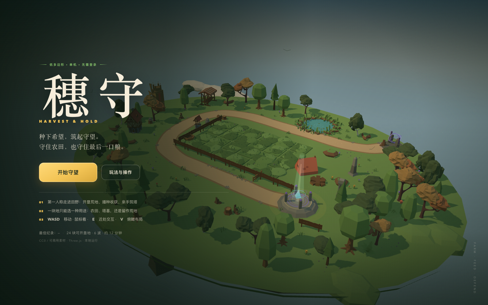 | 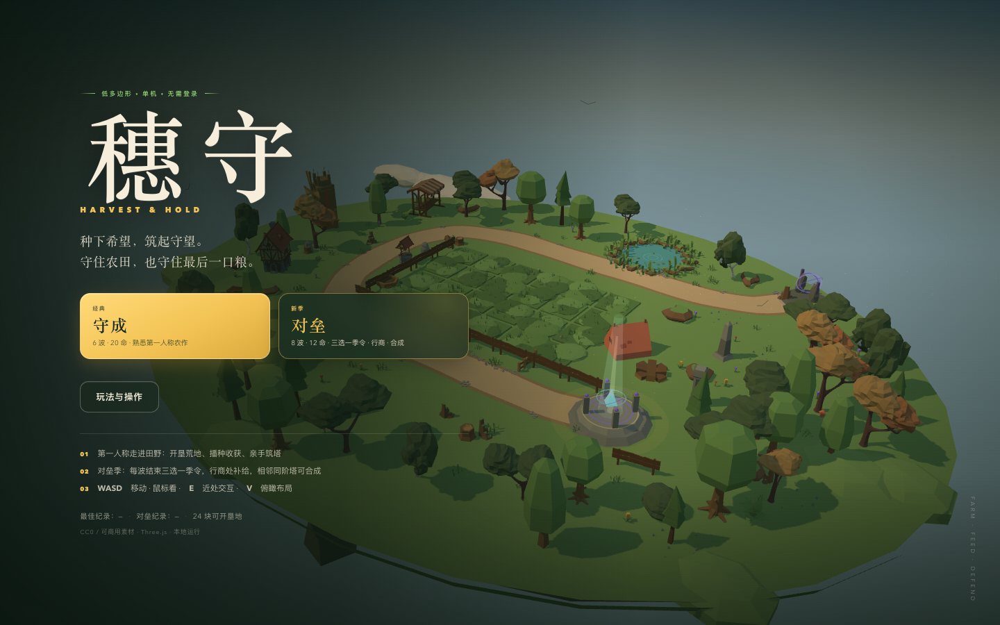 |

- 前：单一“开始守望”，只有经典模式。
- 后：经典/对垒双模式卡，明确波数、生命、季令/行商/合成。

### 10.2 局内 HUD

| 修改前（经典 6 波，无对垒条） | 修改后（对垒 8 波，对垒条 + 季令栏） |
| --- | --- |
| 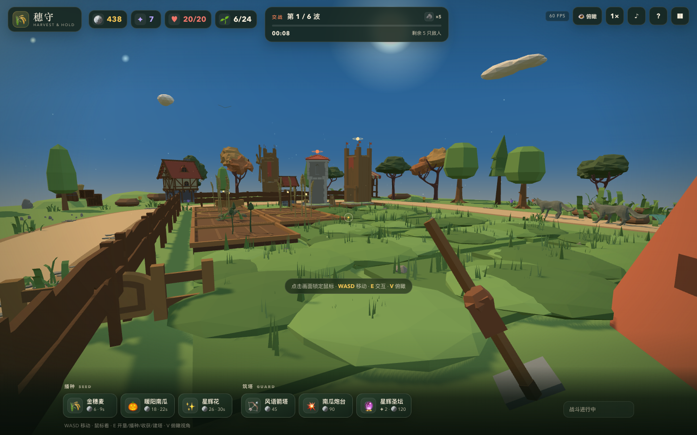 | 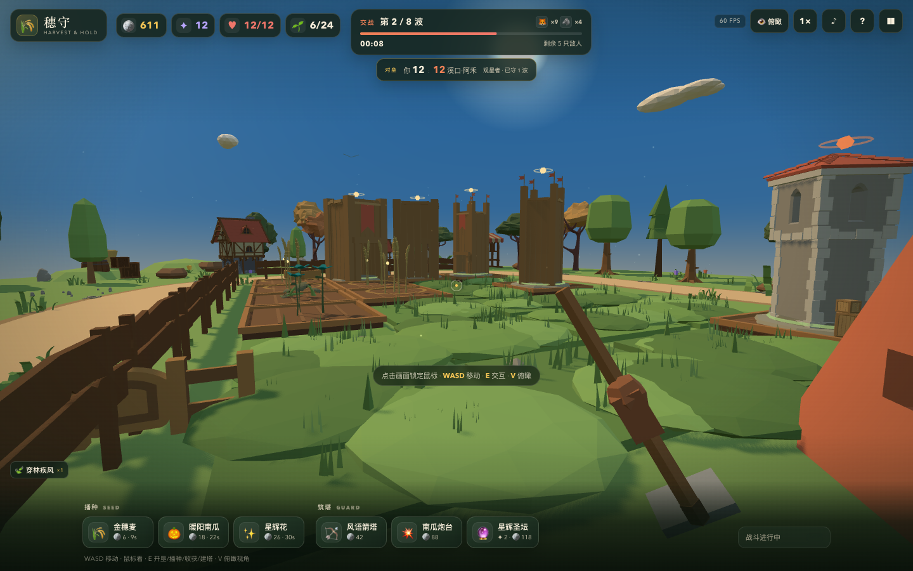 |

- 前：波次 1/6，20 命，无对手。
- 后：波次 1/8，12 命，顶部对垒条，左下季令栏。

### 10.3 波间决策

| 修改前（清波后只有准备计时） | 修改后（清波后三选一季令） |
| --- | --- |
| 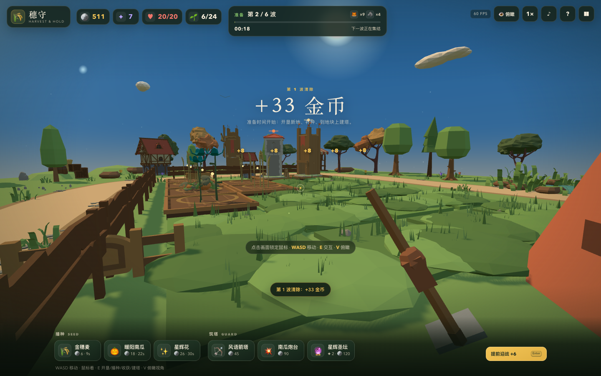 | 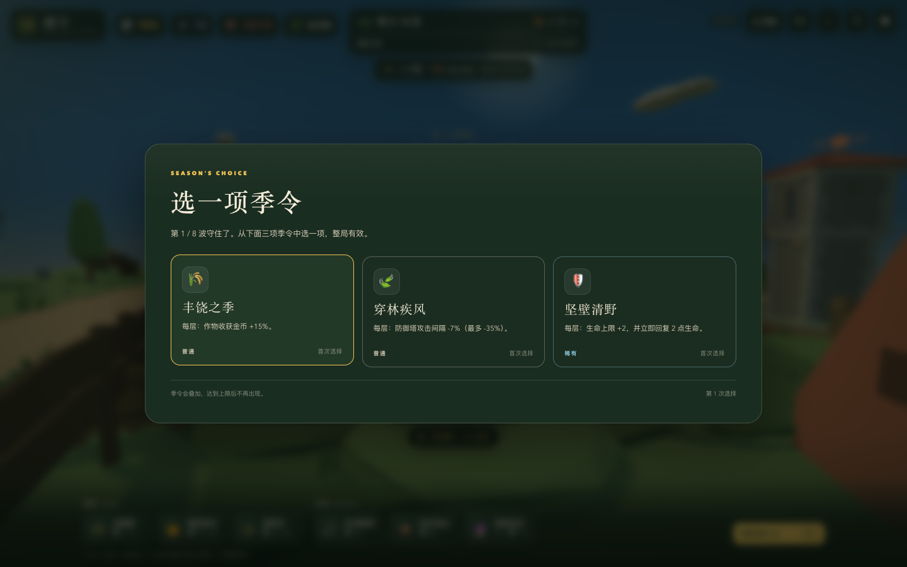 |

- 前：波次清除 banner + 准备计时，玩家只能等。
- 后：三张季令卡，选择后进入行商/下一波。

### 10.4 合成

| 修改前（检查器只有升级/拆除） | 修改后（检查器有合成，相邻同阶可合） |
| --- | --- |
| 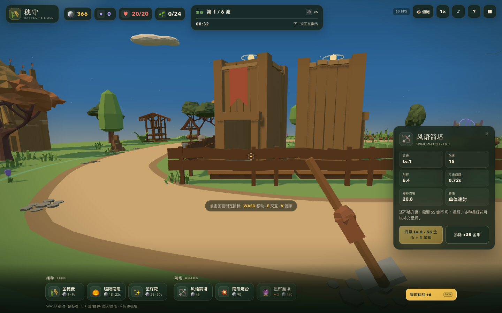 | 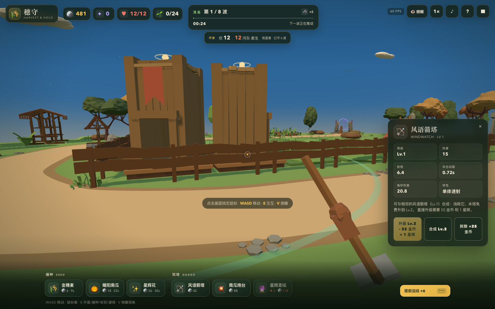 |

- 前：塔只能升级/拆除，空间只增不减。
- 后：相邻同阶塔可合成，检查器显示合成按钮与提示。

### 10.5 商店与移动端

| 行商 | 移动端 HUD | 移动端季令 |
| --- | --- | --- |
| 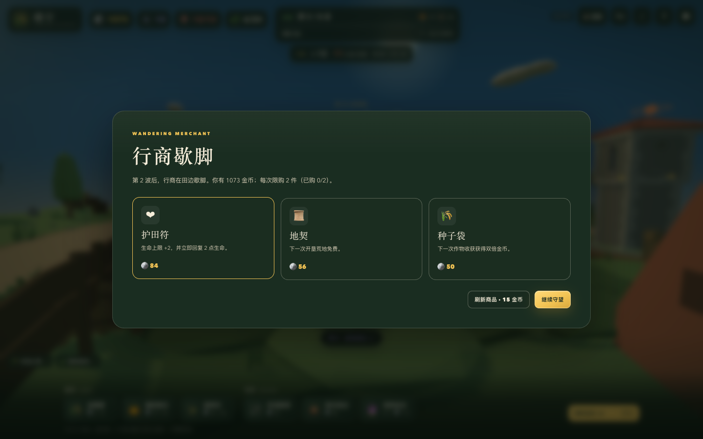 | 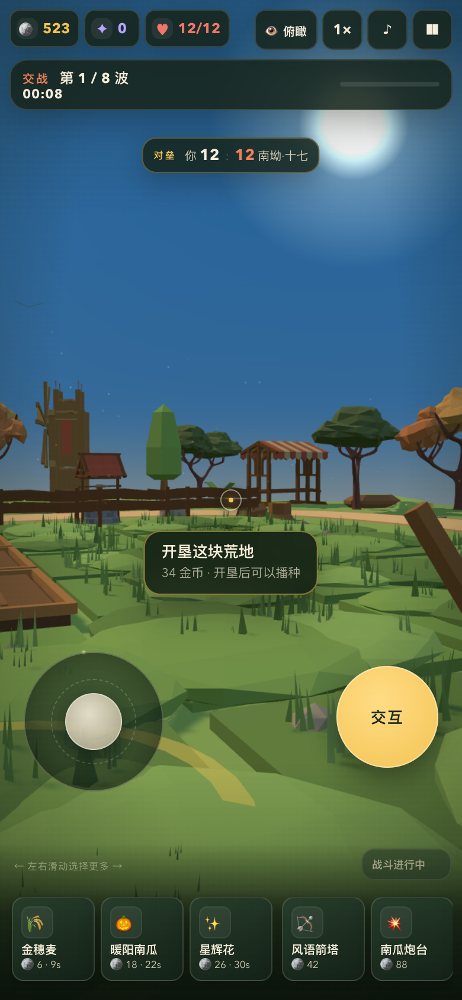 | 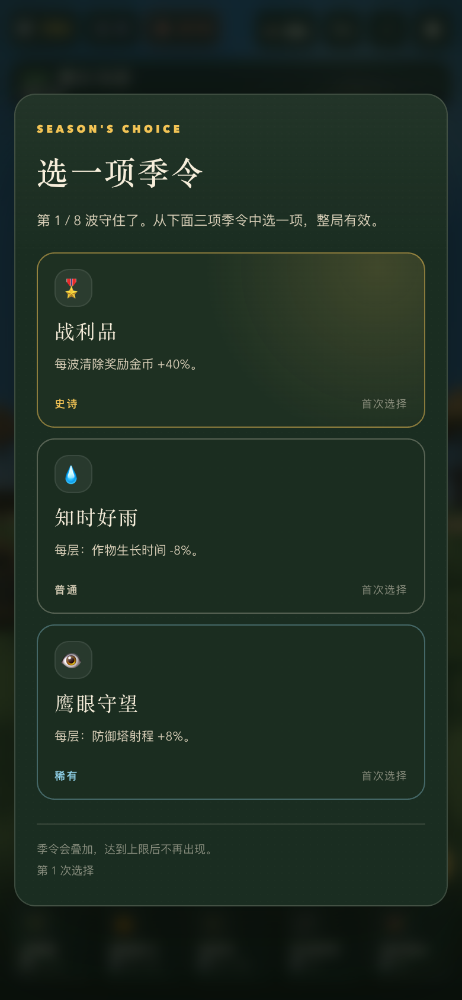 |

移动端菜单对照（左：PR #6 经典单模式；右：v2 双模式）：

| 修改前 | 修改后 |
| --- | --- |
| 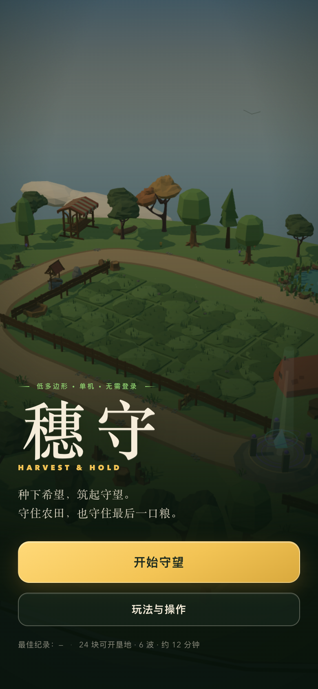 | 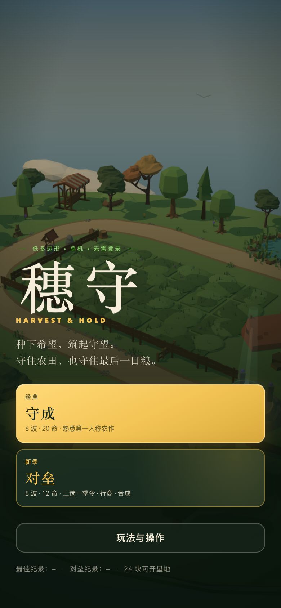 |

### 10.6 结算

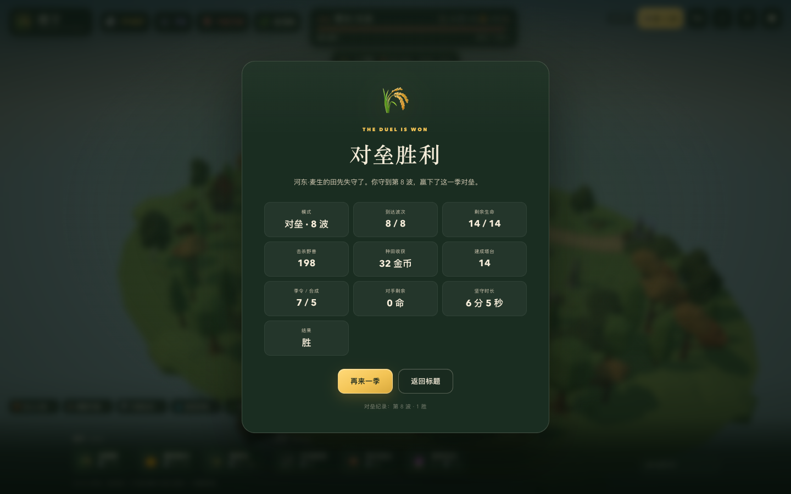

---

## 11. 后续路线（设计完成、未实现）

### S1（本 PR）

- 双模式、8 波对垒、7 次季令、3 次行商、合成、异步 AI 对手、移动端、验收。

### S2（下一季）

- **守望者**：把调研中的“武将字谜”本地化为 3D 作物/动物守护灵；两个同系碎片合成完整守护灵，提供主动技能。
- **每日季风**：每日固定 seed 的波次/季令/商店；每日地图轮换（4 张 3D 地图）。
- **武器/遗物**：给守望者装备，改变攻击模式；蓝色以下可分解。
- **种子码 ghost PvP**：分享一局的防守录像/种子，好友挑战；仍然无实时后端。
- **排行榜**：本地/静态 JSON 排行榜；或接入轻量后端。
- **10 波赛季**：把对垒扩展到 10 波，加入第 9/10 波规则型 Boss。
- **连片折扣/地块分区**：在套利审计后加入。

### S3（长期）

- 联网 PvP/合作、赛季 live-ops、每日任务、成就、无障碍、手柄/平板 UI。

---

## 12. 风险与取舍

| 风险 | 影响 | 缓解 |
| --- | --- | --- |
| 异步 AI 被误解为真人 PvP | 信任下降 | UI 明确“对垒/对手”，不写“在线匹配”；文档/PR 说明 |
| 季令/行商数值未真人验证 | 难度/节奏偏差 | 先做可玩原型；用自动 bot + 真人 playtest 调 |
| 8 波对垒时长偏长 | 手机玩家流失 | 16s 准备、可提前迎战、季令/行商冻结计时；后续做 6 波快速模式 |
| 合成太强/太弱 | 破坏塔位取舍 | 相邻限制、消耗一座塔、Lv.3 上限、合流返还有限 |
| 行商金币通胀 | 商店失去意义 | 限购 2、刷新递增、价格随波次上涨；后续加“市场指数” |
| 第一人称操作摩擦 | 季令/行商打断节奏 | 弹窗只在波间，不强制走动；可跳过等待提前迎战 |
| 没有每日/赛季 | 长期留存不足 | S2 路线图；本 PR 先把单局做扎实 |
| 旧存档/模式串档 | 玩家进度丢失 | 独立字段、缺省 0、只结束时写 |

---

## 13. 结论

《穗守》v2 不是把《赵云与阿斗》的汉字/三国皮搬过来，而是把它最有效的四个结构——**短局、合成换空间、随机 draft、生命预算**——翻译成第一人称 3D 种田塔防的语言：

- 用「季令」把“每波结束”变成 build 决策；
- 用「合成」把“塔位只增不减”变成“空间换质量”；
- 用「行商」给金币一个“现在花还是留着”的取舍；
- 用「对垒」给单机一个“对手也在守田”的压力；
- 用「8 波 + 双王」把单局从 6 波延长到有高潮的完整体验。

这套设计保留了 PR #6 的第一人称具身感与 24 块地的空间取舍，同时把“每局都一样”的问题拆成了可调的季令/商店/对手三条随机轴。下一步需要用真人 playtest 验证：12 命是否太紧、8 波是否太长、合成是否太强、行商是否值得买。数值表已经集中在 `config.ts`，调参不需要改逻辑。
