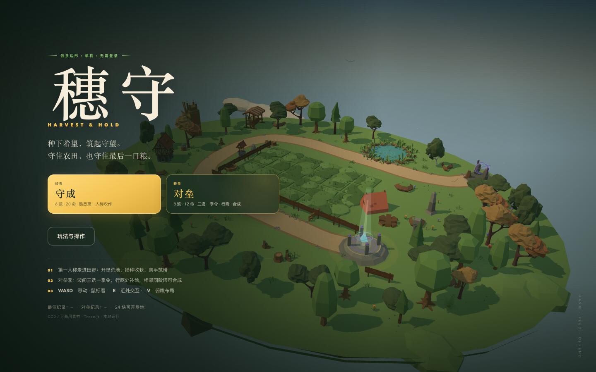
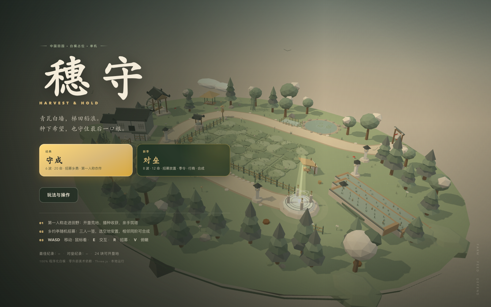
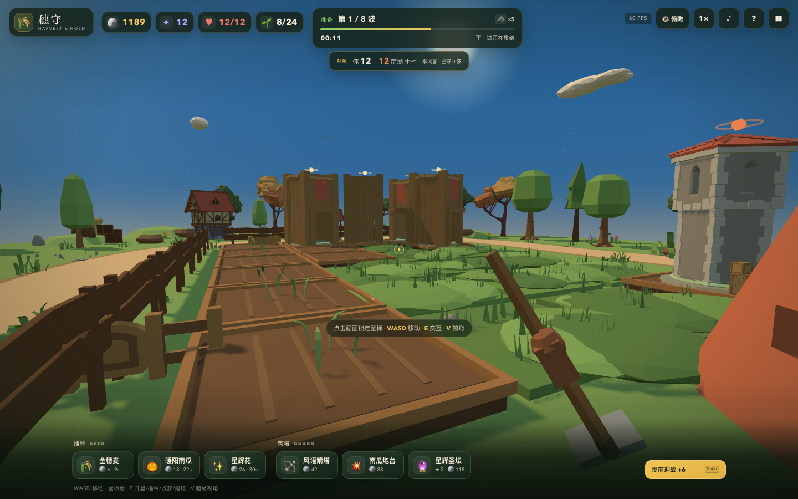
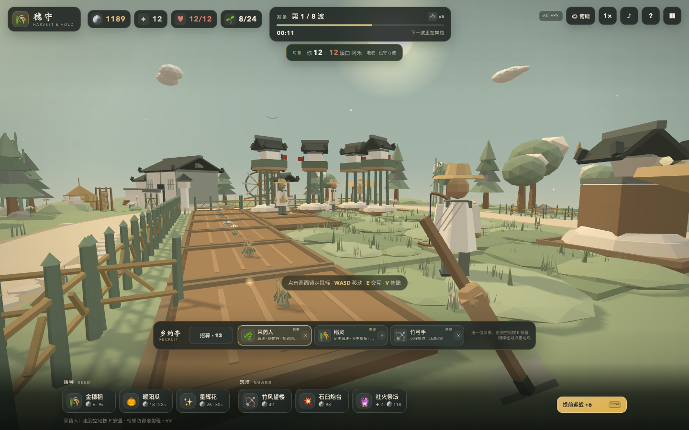

# 《穗守》v3 · 中国田园白模与「随机招募并放置」设计

> 版本：v3.0（中国田园白模季）
> 基线：已合并的 #8 `8d6bd76`（v2 对垒季）
> 范围：美术方向改为中国田园白模、补齐 36 件占位模型的 Blender MCP 提示词、加入《赵云与阿斗》式的随机招募 + 放置 + 相邻光环/合成
> 关联：玩法调研 [`research-zhaoyun-adou.md`](research-zhaoyun-adou.md)，v2 设计 [`design-v2.md`](design-v2.md)，白模提示词 [`whitebox-blender-prompts.md`](whitebox-blender-prompts.md)

---

## 0. 摘要

v3 在 #8 的「守成 / 对垒」两种模式上做两件事：

1. **美术改成中国田园方向**：青瓦白墙、梯田、稻穗、竹篱、社稷坛、水车、田棚；配色收敛到米白、墨灰、暖土、淡青和少量朱砂。因为仓库里没有许可证清晰、又符合中国田园意象的现成素材，v3 的全部物件改为**无贴图、平面着色的程序化白模占位**，不加载任何外部 GLB。
2. **补上《赵云与阿斗》最核心的「随机招募并放置」**：花金币随机抽三名乡勇，待命席选人，走到空地安置；放置占用地块、有相邻光环、同类型同阶可合成。这样「抽卡 → 放置 → 合成 → 扩地 → 对垒」的循环在 #8 的经济、季令、行商、合成、格子扩张和对垒基础上闭环。

所有 36 件占位物在 [`whitebox-blender-prompts.md`](whitebox-blender-prompts.md) 里逐项给出尺寸、比例、朝向、面数预算、风格参考与 GLB 导出参数；清单的机器可读源是 [`../src/game/whitebox-assets.json`](../src/game/whitebox-assets.json)。

---

## 1. 美术方向：中国田园白模

### 1.1 为什么用白模

| 候选方案 | 结论 |
| --- | --- |
| 继续用现有 Quaternius/Kenney CC0 低多边形素材 | 许可证没问题，但它们是西式中世纪村庄/温带森林，与青瓦白墙、梯田、稻穗、竹篱不匹配；强行调色只会得到「西式农场换绿漆」 |
| 找新的中国田园 CC0/商用素材包 | 调研范围内没有找到同时满足「中国田园形制 + 可商用 + GLB + 低模 + 完整部件」的包 |
| 使用来源不明/仅渲染图的素材 | 违反「不要用来源不明资产」，不采用 |
| **程序化白模占位 + Blender 提示词** | 统一、可商用、零外部依赖、可逐件替换；最符合本次验收要求 |

v3 因此不再加载外部 GLB。`main.ts` 直接实例化程序化美术，`window.__harvestAssets` 报告 `mode: 'whitebox'`、0 个外部模型、0 个加载错误；验收脚本会检查运行时没有 `.glb` 请求。

### 1.2 意象与调色板

| 意象 | 游戏内落点 |
| --- | --- |
| 青瓦白墙 | 农舍（白灰墙、墨灰双坡顶、木格窗、院落矮墙）、土地庙石灯 |
| 梯田 | 东侧三级水田（石砌田埂、浅水、绿色秧苗），菜单与俯瞰可见 |
| 稻穗 | 金穗稻作物、社稷坛四角的稻束、晒谷架倒挂的稻穗、梯田秧苗 |
| 竹篱 | 农田边界、田埂、院门、兽径柴门、竹丛 |
| 水墨 | 米白纸感天空/雾、墨灰屋顶与梁柱、淡青植被、浅金发光件 |
| 暖土 | 土路、田床、陶瓮、草垛、梯田田埂 |
| 少量朱砂 | 门、布招、布幡、野兽眼睛等 gameplay 标记 |

允许的调色板（也是 Blender 提示词里的唯一配色）：

| 名称 | 色值 | 用途 |
| --- | --- | --- |
| 米白 | `#f2efe6` | 墙面、布衣、稻粒、白模主体 |
| 暖白 | `#e4ddd0` | 阴影面、石基 |
| 墨灰 | `#4b514c` | 瓦顶、梁柱、眼睛 |
| 中墨 | `#767d75` | 石材、次级结构 |
| 暖土 | `#b09571` | 土、木、皮肤 |
| 草黄 | `#cbb283` | 稻草、斗笠、稻穗 |
| 淡青 | `#8d9f87` | 植物、竹 |
| 朱砂 | `#a84b38` | 门、布招、少量点色 |
| 浅金 | `#e6d6a4` | 发光件、等级珠 |

**诚实边界**：这是「白模/素模」，不是最终美术。它没有贴图、没有法线贴图、没有 PBR 材质；正式模型需要按提示词生成后用 GLB 替换。v3 不声称已经接入任何正式 GLB。

### 1.3 占位清单与替换

36 件占位物分六类：

| 类别 | 数量 | 示例 |
| --- | --- | --- |
| 环境与建筑 | 18 | 青瓦白墙民居、竹木水车、乡集茶棚、青石井、草垛、竹筐、陶瓮、竹篱、松树、竹丛、山石、土地庙石灯、田棚、兽径柴门、社稷坛、梯田段、晒谷架、稻草人 |
| 作物 | 3 | 金穗稻、暖阳瓜、星辉花（同一模型缩放表现 4 个生长阶段） |
| 防御塔 | 3 | 竹风望楼、石臼炮台、社火祭坛（同一模型缩放 + 等级珠表现 3 级） |
| 乡勇 | 6 | 竹弓手、锄禾客、田倌、采药人、石匠、稻灵 |
| 野兽 | 4 | 赤狐、灰狼、荒角野猪、白鹿王 |
| 玩家 | 2 | 第三人称守望者、第一人称锄头 |

- 每件占位物在 [`whitebox-blender-prompts.md`](whitebox-blender-prompts.md) 有独立章节，包含中英文 Blender MCP 提示词。
- 每件的 id 同时是 `WHITEBOX_BUILDERS` 注册表键和 `?gallery=1` 陈列页的条目；缺构建器会在页面与验收脚本中报错。
- 作物 4 阶段、塔 3 级、乡勇 3 阶都通过**同一白模的缩放 + 等级珠**表达，所以清单是「每类一个基础模型」，而不是 12 个作物阶段 / 9 个塔模型；提示词里明确标注了这一点。
- 生成后的 GLB 命名 `public/assets/whitebox/<id>.glb`；本季默认不加载，替换接入说明见提示词文档 §1。

---

## 2. 「随机招募并放置」

### 2.1 目标与参考

《赵云与阿斗》的对局循环是「花馒头征兵 → 一次刷出多张牌 → 把牌拖到已解锁格子 → 同字同级合成 → 扩格 → 对垒」。v3 保留其中三件事：

1. 招募是**随机**的，不能直接买指定单位；
2. 招募之后必须**选择放置位置**，位置本身是有限资源；
3. 放置占用格子、影响相邻单位，同时有**递增成本**防止无限抽卡。

与 #8 的差异：v3 不把防御塔改成抽卡，防御塔仍是可预期的金币购买；**乡勇是独立的、随机招募的放置单位**，与塔、农田争同一批地块。

### 2.2 循环

```text
准备期
  → 点「乡约亭」/按 R，支付递增金币，随机抽 3 名乡勇进入待命席
  → 在待命席选择一位（自动选第一位），走到空地按 E 安置
  → 安置占用地块（荒地或空农田），提供攻击或相邻光环
  → 两名相邻、同类型、同阶乡勇可合成 Lv.2/Lv.3
  → 待命席清空后才能再次招募
  → 下一波
```

### 2.3 数值

| 项 | 数值 | 说明 |
| --- | --- | --- |
| 招募费用 | `12 + 4 × 已招募批次`，封顶 44 金币 | 每次抽 3 人；递增成本是反无限抽卡阀门 |
| 待命席 | 3 人 | 招募时一次填满；必须全部安置或劝返后才能再抽 |
| 抽卡权重 | 竹弓手 30 / 锄禾客 23 / 田倌 19 / 采药人 12 / 石匠 10 / 稻灵 6 | 常见 / 稀有 / 史诗的粗略分层 |
| 同批重复 | 同类型最多 2 张 | 避免三张完全一样，又保留合成机会 |
| 劝返 | 0 金币返还 | 未安置与已安置都可劝返；不返还金币，避免「抽卡—安置—回收」套利 |
| 放置 | 免费，但占用地块 | 地块就是放置成本：放弃该地块的种植/建塔机会 |
| 合成 | 两名相邻、同类型、同阶 → 升一阶 | Lv.3 封顶；合成后另一方地块恢复原状 |
| 等级成长 | 伤害约 ×1.6/阶，射程 +0.3，冷却 ×0.9 | 白模缩放 + 等级珠 |

乡勇基础数值：

| 乡勇 | 稀有 | 定位 | Lv.1 伤害 / 射程 / 间隔 | 相邻光环（每阶 +18%/6%/12%/15% 之一，按类型） |
| --- | --- | --- | --- | --- |
| 竹弓手 | 常见 | 远程单体 | 10 / 5.2 / 0.85s | 无 |
| 锄禾客 | 常见 | 近战范围 | 22 / 2.2 / 1.15s（半径 1.0） | 无 |
| 田倌 | 常见 | 农事辅助 | 不攻击 | 相邻农田生长速度 +18%/阶 |
| 采药人 | 稀有 | 减速 + 塔射程 | 7 / 4.4 / 1.3s（减速 30%） | 相邻防御塔射程 +6%/阶 |
| 石匠 | 稀有 | 塔增伤 + 近战 | 9 / 3.4 / 1.1s | 相邻防御塔伤害 +12%/阶 |
| 稻灵 | 史诗 | 范围减速 + 乡勇增伤 | 12 / 4.6 / 0.9s（减速 20%） | 相邻乡勇伤害 +15%/阶 |

光环只作用于**上下左右相邻**的地块，不作用于自身和对角线；多个来源可叠加。

### 2.4 放置规则与代价

- 可放置：`wild` 或空 `farmland`（无作物、无焦土、无开垦中、无塔/乡勇）。
- 不可放置：塔基、已有乡勇、焦土、开垦中、有作物（先收获或换地）。
- 放置后地块 `state = 'guardian'`，`underlying` 记录原状态；劝返后恢复荒地/农田。
- 放置不消耗额外金币；**成本 = 招募批次金币 + 地块机会成本 + 放弃该地块的种植/建塔收益**。
- 俯瞰视角可以直接点击地块安置乡勇；第一人称要走到地块旁按 E。两条路径对所有玩家一致，不是作弊。

### 2.5 UI 与操作

- **乡约亭**：底部中央的招募条，显示本次费用、待命席三人、稀有度、光环摘要、劝返按钮。
- 点击卡片选中；选中后空地会出现范围提示，按 E 或俯瞰点击地块安置。
- 已安置乡勇可点击/按 E 打开检查器：阶位、伤害、射程、光环、相邻乡勇数、合成、劝返。
- `R` 招募；`7`/`8`/`9` 选待命席第 1/2/3 位；`E` 安置/查看；`V` 俯瞰后点击地块。
- 招募条在桌面宽 800px、移动端横向滚动；移动端检查器/toast 上移，避免遮挡。

### 2.6 边界规则

1. 待命席满时不能招募；招募按钮禁用，按 R 给出提示。
2. 金币不足时不能招募；错误提示写出本次费用。
3. 同批最多两张同类型；抽卡不会出现未知 id。
4. 作物/焦土/开垦中/塔/乡勇地块都不能放置；错误提示明确原因。
5. 乡勇不返还金币；免套利。
6. 合成消耗一方，另一方地块恢复 `underlying`；合成后 Lv.3 封顶。
7. 乡勇伤害/减速/光环在每次攻击/生长时实时计算，不缓存；合成/劝返后刷新相邻塔的射程环与检查器。
8. 乡勇光环不会叠加到自身；多个同类型光环可叠加。
9. 对垒 AI 对手不招募，保持 #8 的异步镜像节奏；招募是玩家侧 build 变量。
10. 进行中状态仍只保存在内存，刷新重开；最佳纪录/胜场/静音继续存 `localStorage`。

---

## 3. 与 #8 机制的对齐

| 《赵云与阿斗》 | #8 已有 | v3 调整 |
| --- | --- | --- |
| 随机征兵 | 无 | **新增**：3 人随机批次、递增费用、待命席、劝返 |
| 放置到已解锁格子 | 塔可建在荒地/农田 | **新增**：乡勇可放在荒地/空农田；占用地块；与塔/农田竞争 |
| 同字同级合成 | 相邻同类型同阶塔合成 | **扩展**：乡勇也支持相邻同类同阶合成；塔合成保留 |
| 馒头经济 | 金币/星辉 | 招募成为新的金币消耗口；收获/击杀/波次奖励不变 |
| 洛阳铲扩格 | 24 块荒地递增开垦 | 保留；乡勇可以直接放在荒地，所以「先开田还是先站人」成为新取舍 |
| 随机 draft / 保底 | 季令三选一 + 行商 | 保留；招募的「同批最多两张重复」是轻量去重，不做复杂保底 |
| 1v1 对垒 | 异步 AI 镜像 | 保留；乡勇不改变对垒胜负条件 |
| 每日 build | 季令/行商/对手随机 | 保留；随机招募增加每局 build 差异 |

---

## 4. 技术实现

| 文件 | 作用 |
| --- | --- |
| `src/game/config.ts` | `GUARDIANS`、`RECRUIT_RULES`、作物/塔/敌人改名与白模 key |
| `src/game/types.ts` | `GuardianId`、`GuardianDef`、`GuardianRuntime`、`GuardianDraftCard`、`PlotState = 'guardian'` |
| `src/game/models.ts` | 中国田园白模的作物/塔/乡勇/野兽/环境构建器 + `WHITEBOX_BUILDERS` 注册表 |
| `src/game/world.ts` | 墨色/暖土调色板、梯田、竹丛、晒谷架、稻草人、石灯、水田、青瓦屋顶修正 |
| `src/game/game.ts` | 招募/待命席/放置/合成/劝返/光环/乡勇战斗/调试 API |
| `src/game/ui.ts` / `index.html` / `style.css` | 乡约亭招募条、检查器、移动端、中国田园 UI 配色 |
| `src/gallery.ts` | `?gallery=1` 白模陈列页（36 件、类别/单项筛选） |
| `src/game/whitebox-assets.json` | 36 件白模的尺寸/朝向/面数/提示词源数据 |
| `scripts/build-whitebox-doc.mjs` | 从 JSON 生成提示词文档 |
| `scripts/screenshots-pastoral.mjs` | 修改后截图与白模类别图 |

### 调试 API（`?debug=1`）

新增：`recruit()`、`selectGuardian(uid)`、`placeGuardian(plot, uid?)`、`dismissBench(uid)`、`dismissGuardian(plot)`、`mergeGuardian(plot)`、`selectGuardianAt(plot)`、`canMergeGuardian(plot)`、`addGuardianCard(id, count)`（仅测试用）。`getState()` 增加 `guardians`、`recruits`、`towerAuras`。

---

## 5. 验收与证据

- `npm run build`：TypeScript + Vite 静态构建通过；繁忙场景 60.1 fps（P95 18.6 ms，198 draw calls / 104,320 三角面）。
- `npm run verify`：构建 + 生产预览 + Playwright；92 / 92 项通过，新增招募/放置/合并/光环/白模清单检查。
- `npm run screenshots:pastoral`：生成修改后的菜单、局内、招募、检查器、梯田、移动端与白模类别图。
- 修改前截图来自 `8d6bd76`（#8 合并后的 main）的独立构建；修改后来自本分支生产构建。两者使用 1440 × 900 或 390 × 844 同一视口、同一场景阶段。

| 修改前（#8） | 修改后（v3） |
| --- | --- |
|  |  |
|  |  |

白模类别图：`whitebox-overview.png`、`whitebox-environment.png`、`whitebox-tower.png`、`whitebox-guardian.png`、`whitebox-crop.png`、`whitebox-enemy.png`、`whitebox-player.png`。

### 已知限制

- 这是白模占位，不是正式中国田园美术；正式模型仍需按提示词生成并接入。
- 没有外部 GLB 运行时依赖；`public/assets` 里的 CC0 文件保留作历史/许可证对照，v3 不加载。
- 乡勇数值与 3 人批次是第一版平衡；自动验收覆盖流程与光环，不等同于真人 playtest。
- 对垒仍是本地异步 AI 镜像，不是联网 PvP。
- 不实现《赵云与阿斗》的每日轮换、军衔、广告、武器与武将字谜；这些不属于本次范围。

---

## 6. 后续路线

1. 按提示词生成正式中国田园 GLB，优先替换农舍、社稷坛、三座塔和六位乡勇；加入 `public/assets/whitebox/` 与加载清单。
2. 给乡勇加第二套技能/升阶外观；把「同批最多两张重复」升级为按局保底。
3. 用真人 playtest 调整招募费用、乡勇伤害与光环数值。
4. 增加地图/每日轮换与排行榜前，先保持离线、可复现、无后端。
